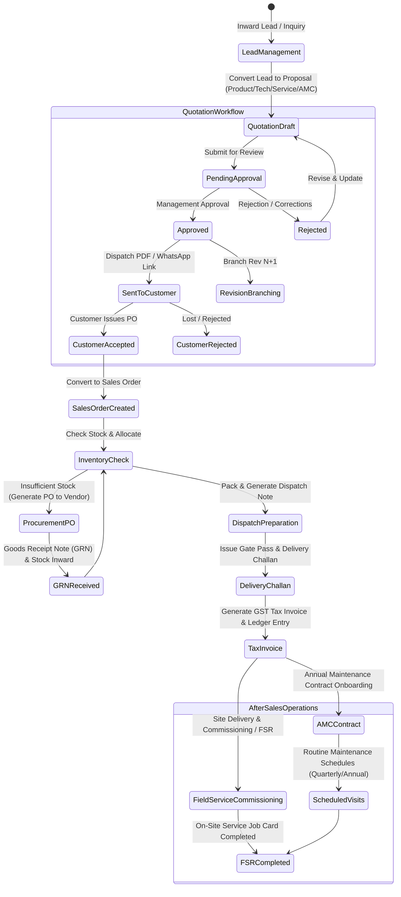

# System Architecture & Technical Design

This document details the enterprise software architecture, domain boundaries, data flow, state management, authoritative calculation engines, PDF generation pipeline, and design patterns implemented across the **Taneja Power CRM & Enterprise Engineering Management System**.

---

## 1. High-Level Architecture Overview

The platform follows a decoupled, client-server architecture with strict layer isolation, domain encapsulation, authoritative server-side business rules, and multi-tier integrations:

```mermaid
graph TD
    AdminClient["Admin & Sales Web Portal (React 19 + Vite + TypeScript)"] -->|"HTTP REST API (JSON Envelope & PDF Streams)"| Backend["Express.js Server (Node.js + TS)"]
    SalesApp["Mobile Field App (React Native Expo Router)"] -->|"HTTP REST API (JSON Envelope)"| Backend
    Backend -->|"Drizzle ORM Layer"| Postgres[("PostgreSQL Database")]

    subgraph Core Commercial & Operational Pipeline
        Backend --> QuotationService["Quotation Orchestration Service"]
        QuotationService --> CalculationService["Authoritative Financial & GST Engine"]
        QuotationService --> NumberService["Sequential Number Generator (QT/SO/INV/FSR/PO)"]
        QuotationService --> PdfService["PDFKit Document Engine (Streaming Vector PDFs)"]
        Backend --> SalesOrderService["Sales Order & Inventory Reservation Engine"]
        Backend --> ProcurementService["Procurement & GRN Material Inward Engine"]
        Backend --> DispatchService["Dispatch Note & Delivery Challan Engine"]
        Backend --> InvoiceService["GST Tax Invoicing & Ledger Engine"]
        Backend --> FieldService["Field Service & AMC Lifecycle Engine"]
    end

    subgraph Backend Geocoding Pipeline
        Backend --> GeocodingService["Geocoding Orchestrator Service"]
        GeocodingService -->|"Primary (Server Key)"| GooglePlaces["Google Places / Geocoding API"]
        GeocodingService -->|"Fallback 1 (India Only)"| Nominatim["OSM Nominatim Geocoder"]
        GeocodingService -->|"Fallback 2 (India Only)"| Photon["Photon Komoot Geocoder"]
    end

    subgraph Messaging Gateway
        Backend --> WhatsAppService["WhatsApp Notification Gateway API"]
    end

    subgraph Layered Server Architecture
        Routes["Express Routes (/api/v1/*)"] --> Middleware["Auth, Role Guards & Zod Validators"]
        Middleware --> Controllers["Thin Controllers"]
        Controllers --> Services["Domain Business Services"]
        Services --> Repositories["Data Repositories"]
        Repositories --> Drizzle["Drizzle ORM Schema"]
    end
```



---

## 2. End-to-End Enterprise Commercial & Engineering Lifecycle

The system models the complete industrial equipment sales, engineering, manufacturing, dispatch, billing, and after-sales service lifecycle:



---

## 3. Enterprise Quotation & Proposal Subsystem

The Quotation Module manages high-value commercial and technical proposals for heavy electrical machinery, substations, and energy equipment. It enforces five core architectural principles:

### 3.1 Immutable Revision Snapshot Pattern
1. **Zero Data Drift**: Master customer information and product catalog prices change over time. To ensure that historical proposals remain 100% auditable and legally binding, each quotation revision freezes a complete snapshot of:
   - Customer legal name, company, GSTIN, PAN, billing address, and contact details.
   - Line items: SKU, descriptions, unit rates, custom discounts, HSN/SAC codes, and technical specifications.
   - Commercial and warranty terms: payment schedule, delivery terms, warranty duration, freight and transit terms.
2. **Sequential Revision Branching**: When an approved or dispatched proposal needs modification, the system creates a new revision `Rev N+1` in `DRAFT` status, retaining previous revisions as immutable historical records.

### 3.2 Authoritative Financial & Multi-Tier GST Engine
- **Server Authority**: The backend [`quotation-calculation.service.ts`](file:///c:/Users/USER/OneDrive/Desktop/taneja_new/Taneja-Power-CRM/server/src/modules/quotations/services/quotation-calculation.service.ts) is the single source of truth for all calculations. The frontend and PDF generators never calculate totals or tax breakdowns independently.
- **Line-Level Calculation Algorithm**:
  $$\text{Base Amount} = \text{Quantity} \times \text{Unit Price}$$
  $$\text{Discount Amount} = \text{Base Amount} \times \frac{\text{Discount \%}}{100}$$
  $$\text{Taxable Amount} = \text{Base Amount} - \text{Discount Amount}$$
  - **Intra-State (Gujarat $\rightarrow$ Gujarat)**:
    $$\text{CGST} = \text{Taxable Amount} \times \frac{\text{GST \%}}{200}, \quad \text{SGST} = \text{Taxable Amount} \times \frac{\text{GST \%}}{200}, \quad \text{IGST} = 0$$
  - **Inter-State (Gujarat $\rightarrow$ Other Indian States)**:
    $$\text{IGST} = \text{Taxable Amount} \times \frac{\text{GST \%}}{100}, \quad \text{CGST} = 0, \quad \text{SGST} = 0$$
  $$\text{Line Total} = \text{Taxable Amount} + \text{CGST} + \text{SGST} + \text{IGST}$$
- **Document-Level Totals & Roundoff**:
  $$\text{Subtotal} = \sum \text{Base Amount}, \quad \text{Total Discount} = \sum \text{Discount Amount}$$
  $$\text{Taxable Amount} = \sum \text{Taxable Amount}$$
  $$\text{Grand Total} = \text{Taxable Amount} + \text{Total Tax} + \text{Freight} + \text{Other Charges} + \text{Roundoff}$$
- **Indian Numbering Amount in Words Engine**: Formats the grand total into legal words (e.g. *"One Lakh Three Thousand Eight Hundred Ninety Indian Rupees Only"*).

### 3.3 Server-Side PDF & Print Engine Architecture
- **PDFKit Streaming Engine**: Generates vector-sharp A4 PDF documents on demand via `GET /api/v1/quotations/:id/pdf` and `GET /api/v1/quotations/:id/revisions/:revisionNumber/pdf`.
- **Dynamic Multi-Page Numbering**: Uses PDFKit page buffering (`bufferPages: true`) and calculates the exact document page count dynamically (`Page X of Y`), preventing phantom trailing pages and overflow clipping.
- **Strict Status Guarding**: Only genuine approval records with valid reviewer IDs are rendered in the signature block. Draft and Pending proposals cleanly indicate `Draft Proposal (Unapproved)` without fabricated dates.
- **Client-Side High-Resolution Print**: Built using CSS `@media print` rules with standard A4 boundaries (`210mm x 297mm`), repeating `thead` table headers, and suppression of CRM application chrome.

---

## 4. Multi-Provider Geocoding Architecture

The destination management subsystem features a provider-agnostic location pipeline designed to resolve informal Indian address patterns (e.g. *"Dhyan Residency near Harni Water Tank"*, *"Vadsar Vadodara"*, *"Nilamber Triumph"*):

1. **Server-Side Key Isolation**: The `GOOGLE_MAPS_API_KEY` is maintained exclusively within `server/.env` and is never exposed to client-side JS bundles.
2. **Normalized Response Schema**: Regardless of whether a location is resolved via Google Maps, Nominatim, or Photon, the API normalizes output into a single unified contract (`NormalizedLocationResult`).
3. **Multi-Tier Landmark Sub-Query Fallback**: When informal landmark queries are entered, the service strips filler prepositions (`near`, `opp`, `behind`, `beside`) and extracts area sub-queries to guarantee location suggestions even on fallback providers.
4. **Race Condition & Stale Request Prevention**: Frontend requests are debounced (350ms) and use `AbortController` signals to cancel previous in-flight HTTP calls on rapid typing.

---

## 5. Backend Layer Architecture

The server implements a clean **Layered Architecture** where each layer has a single responsibility and strictly communicates with adjacent layers:

```text
HTTP Request
     ↓
Route Layer             (server/src/modules/*/routes/*.routes.ts)
     ↓
Middleware Layer        (server/src/common/middleware/* & auth middleware)
     ↓
Validation Layer        (server/src/modules/*/validators/*.validator.ts)
     ↓
Controller Layer        (server/src/modules/*/controllers/*.controller.ts)
     ↓
Service Layer           (server/src/modules/*/services/*.service.ts)
     ↓
Repository Layer        (server/src/modules/*/repositories/*.repository.ts)
     ↓
Drizzle ORM Schema      (server/src/database/schema/*)
     ↓
PostgreSQL Database
```

---

## 6. Complete Database Schema Architecture

Database tables are managed via **Drizzle ORM** with migration tracking in `server/drizzle/`:

| Schema File | Table Name(s) | Primary Domain & Responsibility |
| :--- | :--- | :--- |
| [`users.ts`](file:///c:/Users/USER/OneDrive/Desktop/taneja_new/Taneja-Power-CRM/server/src/database/schema/users.ts) | `users` | User credentials, roles (`ADMIN`, `MANAGER`, `USER`, `ACCOUNTANT`, `SALES`, `ENGINEER`), employee mappings, and profile metadata |
| [`refreshTokens.ts`](file:///c:/Users/USER/OneDrive/Desktop/taneja_new/Taneja-Power-CRM/server/src/database/schema/refreshTokens.ts) | `refresh_tokens` | Cryptographic JWT refresh token rotation with device telemetry and expiry tracking |
| [`customers.ts`](file:///c:/Users/USER/OneDrive/Desktop/taneja_new/Taneja-Power-CRM/server/src/database/schema/customers.ts) | `customers`, `customer_destinations` | Master client directory, GSTIN, PAN, billing details, multi-facility plant destinations, GPS coordinates, and site notes |
| [`products.ts`](file:///c:/Users/USER/OneDrive/Desktop/taneja_new/Taneja-Power-CRM/server/src/database/schema/products.ts) | `products` | Master engineering catalog, SKUs, categories, unit prices, stock reserves, and active statuses |
| [`leads.ts`](file:///c:/Users/USER/OneDrive/Desktop/taneja_new/Taneja-Power-CRM/server/src/database/schema/leads.ts) | `leads` | Sales opportunities, product interested from live catalog, expected deal values (₹0 default), stage pipelines, and activity logs |
| [`follow-ups.ts`](file:///c:/Users/USER/OneDrive/Desktop/taneja_new/Taneja-Power-CRM/server/src/database/schema/follow-ups.ts) | `follow_ups` | Follow-up schedules, priority levels, entity links (Leads, Quotations, Deals), reminder timestamps, and completion statuses |
| [`quotations.ts`](file:///c:/Users/USER/OneDrive/Desktop/taneja_new/Taneja-Power-CRM/server/src/database/schema/quotations.ts) | `quotations`, `quotation_revisions`, `quotation_items`, `quotation_approvals` | Root quotations, master numbers (`QT/2026-27/XXXX`), immutable snapshots, line items, multi-tier GST rates, approval audits, and Amount in Words |
| [`sales-orders.ts`](file:///c:/Users/USER/OneDrive/Desktop/taneja_new/Taneja-Power-CRM/server/src/database/schema/sales-orders.ts) | `sales_orders`, `sales_order_items` | Confirmed customer sales orders converted from accepted proposals, delivery commitments, and item snapshots |
| [`procurement.ts`](file:///c:/Users/USER/OneDrive/Desktop/taneja_new/Taneja-Power-CRM/server/src/database/schema/procurement.ts) | `vendors`, `purchase_orders`, `purchase_order_items`, `goods_receipt_notes` | Vendor master, purchase orders, procurement workflows, and Goods Receipt Notes (GRN) |
| [`inventory.ts`](file:///c:/Users/USER/OneDrive/Desktop/taneja_new/Taneja-Power-CRM/server/src/database/schema/inventory.ts) | `stock_movements` | Stock inward/outward ledger, warehouse reservations, quantity adjustments, and audit traces |
| [`dispatch.ts`](file:///c:/Users/USER/OneDrive/Desktop/taneja_new/Taneja-Power-CRM/server/src/database/schema/dispatch.ts) | `dispatch_notes`, `dispatch_items` | Packing slips, carrier tracking, vehicle numbers, Gate Pass, and Delivery Challan tracking |
| [`invoices.ts`](file:///c:/Users/USER/OneDrive/Desktop/taneja_new/Taneja-Power-CRM/server/src/database/schema/invoices.ts) | `invoices`, `invoice_items`, `payments` | GST Tax Invoices, line item tax breakdowns, payment logs, and accountant ledger tracking |
| [`field-service.ts`](file:///c:/Users/USER/OneDrive/Desktop/taneja_new/Taneja-Power-CRM/server/src/database/schema/field-service.ts) | `field_service_orders`, `field_service_reports`, `fsr_spares_used` | Breakdown dispatches, on-site Field Service Reports (FSR), fault diagnosis, replaced spares, and customer sign-off |
| [`amc-contracts.ts`](file:///c:/Users/USER/OneDrive/Desktop/taneja_new/Taneja-Power-CRM/server/src/database/schema/amc-contracts.ts) | `amc_contracts`, `amc_service_schedules`, `amc_contract_equipment` | Annual Maintenance Contracts, asset serial numbers, service visit frequency, and visit completion logs |
| [`tasks.ts`](file:///c:/Users/USER/OneDrive/Desktop/taneja_new/Taneja-Power-CRM/server/src/database/schema/tasks.ts) | `tasks` | Field workforce dispatches, assigned engineers, priority, status lifecycle, and real-time GPS telemetry logs |
| [`attendance.ts`](file:///c:/Users/USER/OneDrive/Desktop/taneja_new/Taneja-Power-CRM/server/src/database/schema/attendance.ts) | `attendance` | Field and office personnel attendance punches with verified GPS coordinates, shift durations, and timestamps |

---

## 7. Frontend Architecture & Enterprise UX Design System

The admin web portal is built using **React 19 + TypeScript + Vite** following a **Feature-Driven Architecture**:

```text
client/src/
├── app/                  # Infrastructure (API client, router, providers, auth guards)
├── components/           # Shared Design System (Header, Sidebar, Modals, Cards, Table, StatusPill, Toast)
├── features/             # Feature Domain Modules
│   ├── accountant/       # Accountant Dashboard, Invoices & Financial Ledger
│   ├── admin/            # Admin Management, User Operations, Audit Logs
│   ├── amc-contracts/    # AMC Management, Service Visit Schedules & Service Reports
│   ├── attendance/       # Employee GPS Attendance & Admin Shift Telemetry
│   ├── auth/             # Authentication, JWT Session Management & Role Switcher
│   ├── customers/        # Customer Directory & Multi-Facility Destination Modals
│   ├── dispatch/         # Dispatch Notes, Delivery Challans & Gate Passes
│   ├── employee/         # Employee Portal, Metrics Grid & Shift Controls
│   ├── field-service/    # Field Service Reports (FSR), Job Cards & Spares Tracking
│   ├── follow-ups/       # Entity-Linked Follow-Up Schedulers & Reminders
│   ├── inventory/        # Stock Reserves, Movement Ledger & Adjustments
│   ├── invoices/         # GST Tax Invoices, Payment Tracking & PDF Export
│   ├── leads/            # Leads Management, Product Catalog Selection & Deals Pipeline
│   ├── procurement/      # Vendor Directory, Purchase Orders & GRN Material Inward
│   ├── products/         # Product Catalog, Equipment Specifications & SKU Pricing Master
│   ├── profile/          # User Profile & Security Credentials
│   ├── quotations/       # Complete Commercial & Technical Quotation Studio, Revisions & PDF Engine
│   ├── sales-orders/     # Sales Order Processing from Accepted Quotations
│   ├── tasks/            # Work Order Dispatches & Live Route Tracking Telemetry
│   └── whatsapp/         # WhatsApp Notification Gateway & Dispatch Logs
└── stores/               # Zustand Global Stores (authStore, productStore, etc.)
```

### State Management Separation

| State Category | Technology | Purpose |
| :--- | :--- | :--- |
| **Server Cache State** | `@tanstack/react-query` | Fetching, caching, optimistic mutations, and cache invalidation for quotations, products, customers, orders, and dispatches |
| **Global App State** | `zustand` | User authentication session, tokens, user designations/roles, navigation state |
| **Form & UI State** | `useState` / React hooks | Keystroke debouncing, modal visibility, live line item calculations, map preview triggers, drawer controllers |
