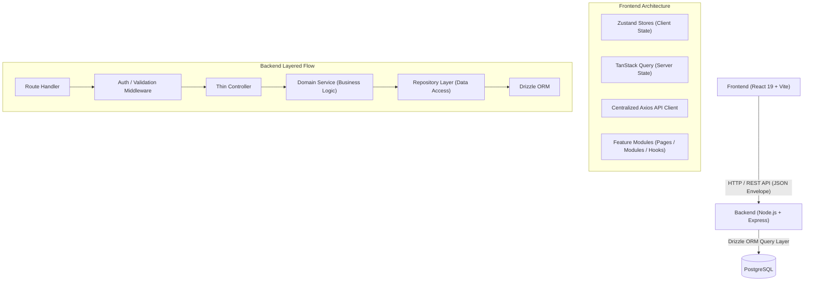

# System Architecture & Technical Design

This document details the enterprise software architecture, domain boundaries, data flow, state management, and design patterns implemented across the application.

---

## 1. High-Level Architecture Overview

The system follows a decoupled, client-server architecture with strict layer isolation:



---

## 2. Backend Layer Architecture

The backend implements a clean **Layered Architecture** where each layer has a single responsibility and strictly communicates with adjacent layers.

```text
HTTP Request
     ↓
Route Layer             (server/src/modules/*/routes/*.routes.ts)
     ↓
Middleware Layer        (server/src/common/middleware/* & module middleware)
     ↓
Validation Layer        (server/src/modules/*/validators/*.validator.ts)
     ↓
Controller Layer        (server/src/modules/*/controllers/*.controller.ts)
     ↓
Service Layer           (server/src/modules/*/services/*.service.ts)
     ↓
Repository Layer        (server/src/modules/*/repositories/*.repository.ts)
     ↓
Drizzle ORM & Schema    (server/src/database/schema/*)
     ↓
PostgreSQL Database
```

### Layer Responsibilities

1. **Route Layer**:
   - Declares URL paths and HTTP verbs.
   - Attaches route-level middleware (auth, permission check, schema validation).
   - Forwards execution to the appropriate controller method.

2. **Middleware & Validation Layer**:
   - Authenticates JWT tokens and checks user role/permissions.
   - Validates incoming request body, query params, and URL params against **Zod schemas**.
   - Terminates bad requests early before entering domain logic.

3. **Controller Layer**:
   - Thin translation layer between HTTP and domain logic.
   - Extracts input data from `req.body`, `req.params`, `req.query`, and authenticated user context.
   - Calls the corresponding Service methods.
   - Formats and sends HTTP responses using the **Standard Response Envelope**.

4. **Service Layer**:
   - Houses all pure domain business logic and workflow orchestration.
   - Agnostic to HTTP constructs (no direct usage of `req` or `res`).
   - Handles transactions and coordination between multiple repositories.

5. **Repository Layer**:
   - Encapsulates all database interactions using Drizzle ORM.
   - Isolates SQL queries and data mapping logic from the business layer.

6. **Database Schema & ORM**:
   - Definitive schema definitions in TypeScript (`server/src/database/schema/`).
   - Migration management via `drizzle-kit`.

---

## 3. Frontend Architecture

The frontend follows a **Feature-Driven Architecture** combined with atomic UI tokens and centralized application infrastructure.

```text
client/src/
├── app/                  # Application Infrastructure
│   ├── api/              # Centralized Axios client & interceptors
│   ├── providers/        # QueryClient, Theme, Toast providers
│   ├── router/           # Application route definitions
│   └── config/           # Validated frontend env variables
│
├── components/           # Shared Design System
│   ├── layout/           # App Layout, Header, Sidebar
│   ├── ui/               # Buttons, Inputs, Cards, Badges, Modals
│   └── feedback/         # Skeletons, Spinners, Error alerts
│
├── features/             # Feature Modules (e.g., products, auth, orders)
│   └── [feature]/
│       ├── pages/        # Thin route pages
│       ├── modules/      # High-level UI sections (Filters, Table, Header)
│       ├── components/   # Feature-specific reusable UI tokens
│       ├── hooks/        # Stateful business hooks & TanStack Query wrappers
│       ├── services/     # Feature API operations
│       ├── types/        # TypeScript interfaces and types
│       ├── validators/   # Zod validation schemas
│       └── utils/        # Feature-specific helpers & formatters
│
├── stores/               # Zustand Global State (auth, UI preferences)
└── ...
```

---

## 4. State Management Separation

The application strictly separates **Server State** from **Client State**:

| State Category | Technology | Usage |
| :--- | :--- | :--- |
| **Server Cache State** | `@tanstack/react-query` | Fetching, caching, invalidating, and synchronizing remote API data |
| **Global Client State** | `zustand` | Authentication session, user tokens, theme, active sidebar state |
| **Local Form/UI State** | `useState` / React hooks | Component-level toggles, modal open states, active tab indexes |

---

## 5. Security & Authentication Flow

1. **Authentication**:
   - Passwords hashed using standard cryptographic algorithms (`bcryptjs`).
   - Stateless JWT tokens signed with secure secrets and strict expiration.
   - Tokens stored securely on the client and injected automatically via the `apiClient` Axios request interceptor.

2. **Authorization (RBAC)**:
   - Role-based permissions evaluated through declarative middleware on the server (`requireRole`, `requirePermission`).

3. **Input Sanitization & Validation**:
   - Double-barrier validation: Frontend validation for instant UX feedback, and Backend Zod validation as an uncompromisable security boundary.
