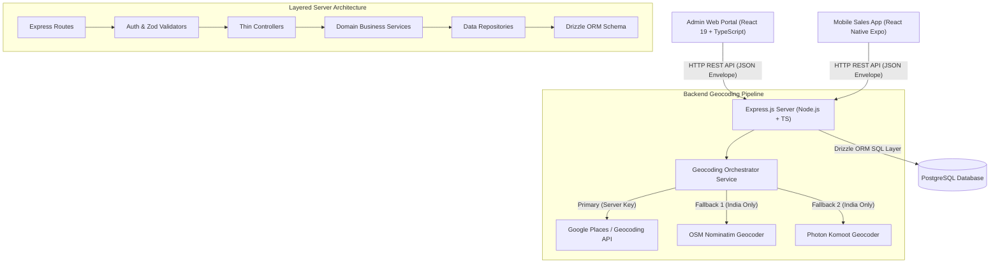
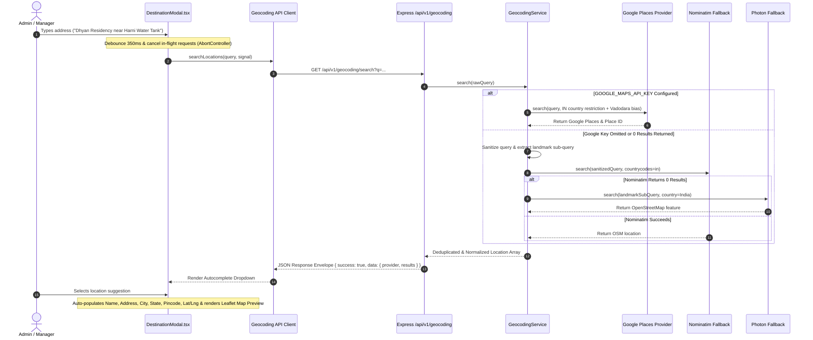

# System Architecture & Technical Design

This document details the enterprise software architecture, domain boundaries, data flow, state management, multi-provider geocoding pipeline, and design patterns implemented across the Taneja Power CRM & Field Workforce Management System.

---

## 1. High-Level Architecture Overview

The system follows a decoupled, client-server architecture with strict layer isolation and provider abstraction:



---

## 2. Multi-Provider Geocoding Architecture

The destination management subsystem features a production-grade, provider-agnostic location pipeline designed to resolve informal Indian address patterns (e.g. *"Dhyan Residency near Harni Water Tank"*, *"Vadsar Vadodara"*, *"Nilamber Triumph"*).

### 2.1 Provider Orchestration Flow



### 2.2 Key Architectural Principles:

1. **Server-Side Key Isolation**: The `GOOGLE_MAPS_API_KEY` is maintained exclusively within `server/.env` and is never exposed to client-side JS bundles.
2. **Normalized Response Schema**: Regardless of whether a location is resolved via Google Maps, Nominatim, or Photon, the API normalizes output into a single unified contract:
   ```ts
   interface NormalizedLocationResult {
     id: string;
     provider: 'google' | 'nominatim' | 'photon';
     placeId?: string;
     displayName: string;
     name: string;
     formattedAddress: string;
     city: string;
     state: string;
     pincode: string;
     country: string;
     latitude: number;
     longitude: number;
   }
   ```
3. **Multi-Tier Landmark Sub-Query Fallback**:
   When informal landmark queries are entered (e.g., *"Dhyan Residency near Harni water tank vadodara"*), the service strips filler words (`near`, `opp`, `behind`, `beside`) and extracts area sub-queries (e.g., *"Harni water tank vadodara"*) to guarantee location suggestions even on fallback providers.
4. **Race Condition & Stale Request Prevention**:
   Frontend requests are debounced (350ms) and use `AbortController` signals to cancel previous in-flight HTTP calls on rapid typing, ignoring Axios `ERR_CANCELED` signals without throwing spurious error alerts.

---

## 3. Backend Layer Architecture

The server implements a clean **Layered Architecture** where each layer has a single responsibility and strictly communicates with adjacent layers:

```text
HTTP Request
     ↓
Route Layer             (server/src/modules/*/routes/*.routes.ts)
     ↓
Middleware Layer        (server/src/common/middleware/* & auth middleware)
     ↓
Validation Layer        (server/src/modules/*/validators/*.validator.ts)
     ↓
Controller Layer        (server/src/modules/*/controllers/*.controller.ts)
     ↓
Service Layer           (server/src/modules/*/services/*.service.ts)
     ↓
Repository Layer        (server/src/modules/*/repositories/*.repository.ts)
     ↓
Drizzle ORM Schema      (server/src/database/schema/*)
     ↓
PostgreSQL Database
```

### Layer Responsibilities

1. **Route Layer**: Declares REST endpoints, HTTP verbs, and attaches middleware.
2. **Middleware & Validation Layer**: Verifies JWT authentication tokens, user roles (`ADMIN`, `MANAGER`, `EMPLOYEE`), and validates request parameters using Zod schemas.
3. **Controller Layer**: Extracts parameters from HTTP requests and delegates execution to domain services, returning standard response envelopes via `sendResponse`.
4. **Service Layer**: Houses domain business logic, geocoding fallback orchestration, and cross-repository transactions.
5. **Repository Layer**: Encapsulates data access using Drizzle ORM queries.
6. **Database Schema**: Centralized Drizzle schema definitions in TypeScript (`server/src/database/schema/`).

---

## 4. Database Schema & Migration Architecture

Database tables are managed via **Drizzle ORM** with migration tracking in `server/drizzle/`.

### `customer_destinations` Schema Specification

```typescript
export const customerDestinations = pgTable(
  'customer_destinations',
  {
    id: uuid('id').defaultRandom().primaryKey(),
    customerId: uuid('customer_id')
      .references(() => customers.id, { onDelete: 'cascade' })
      .notNull(),
    name: varchar('name', { length: 255 }).notNull(),
    address: text('address'),
    city: varchar('city', { length: 100 }),
    state: varchar('state', { length: 100 }),
    pincode: varchar('pincode', { length: 20 }),
    latitude: numeric('latitude', { precision: 10, scale: 7 }),
    longitude: numeric('longitude', { precision: 10, scale: 7 }),
    placeId: varchar('place_id', { length: 255 }), // Google Place ID support
    contactPerson: varchar('contact_person', { length: 255 }),
    contactPhone: varchar('contact_phone', { length: 50 }),
    notes: text('notes'),
    status: varchar('status', { length: 50 }).default('ACTIVE').notNull(),
    createdAt: timestamp('created_at', { withTimezone: true }).defaultNow().notNull(),
    updatedAt: timestamp('updated_at', { withTimezone: true }).defaultNow().notNull(),
  },
  (table) => [
    index('customer_destinations_customer_id_idx').on(table.customerId),
  ]
);
```

---

## 5. Frontend Architecture & Enterprise UX Design System

The admin web portal is built using **React 19 + TypeScript + Vite** following a **Feature-Driven Architecture**:

```text
client/src/
├── app/                  # Infrastructure (API client, router, providers)
├── components/           # Shared UI Design System (Header, Sidebar, Modals, Cards)
├── features/             # Feature Modules
│   ├── admin/            # Dashboard & Reports
│   ├── customers/        # Customer & Destination Sites (DestinationModal.tsx)
│   ├── tasks/            # Task Dispatch & Telemetry
│   ├── employees/        # Employee Management
│   └── attendance/       # Attendance Tracking
└── stores/               # Zustand Global State
```

### Destination Site Registration UX (`DestinationModal.tsx`):
- **Live Autocomplete**: Real-time address suggestions with provider badges (`Google Maps` / `OpenStreetMap`).
- **Smart Field Separation**: Separates **Destination Site Name** (business name) from **Formatted Address**.
- **Interactive Map Preview**: Embedded OpenStreetMap Leaflet iframe map centered at latitude & longitude coordinates.
- **Collapsible Technical Accordion**: Conceals raw Lat/Lng & Google Place ID inside a toggleable "Advanced GPS & Technical Details" section.

---

## 6. State Management Separation

| State Category | Technology | Purpose |
| :--- | :--- | :--- |
| **Server Cache State** | `@tanstack/react-query` | Fetching, caching, and synchronizing remote customer/task data |
| **Global App State** | `zustand` | User authentication session, tokens, active navigation state |
| **Form & UI State** | `useState` / React hooks | Keystroke debouncing, modal visibility, map preview triggers |
