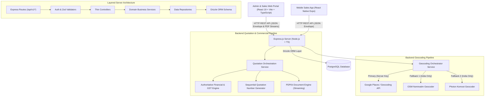
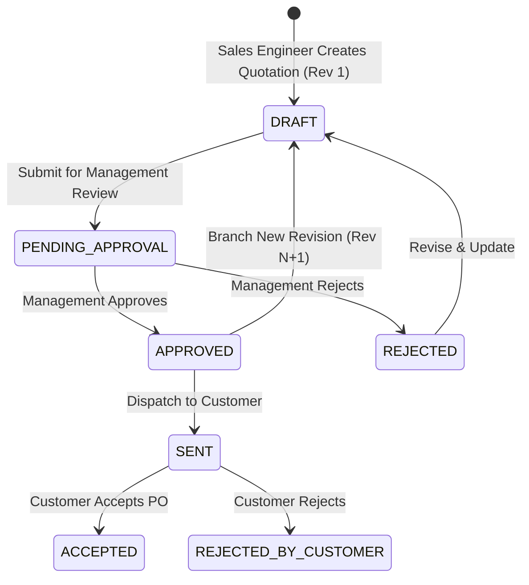

# System Architecture & Technical Design

This document details the enterprise software architecture, domain boundaries, data flow, state management, authoritative quotation calculation engine, PDF generation pipeline, and design patterns implemented across the Taneja Power CRM & Field Workforce Management System.

---

## 1. High-Level Architecture Overview

The system follows a decoupled, client-server architecture with strict layer isolation, domain encapsulation, and authoritative server-side business rules:



---

## 2. Enterprise Quotation Subsystem Architecture

The Quotation Module manages high-value commercial and technical proposals for heavy electrical and energy equipment. It enforces five core architectural principles:



### 2.1 Immutable Revision Snapshot Pattern
1. **Zero Data Drift**: Master customer information and product catalog prices change over time. To ensure that historical proposals remain 100% auditable and legally binding, each quotation revision freezes a complete snapshot of:
   - Customer legal name, company, GSTIN, PAN, billing address, and contact details.
   - Line items: SKU, descriptions, unit rates, custom discounts, HSN/SAC codes, technical specifications.
   - Commercial and warranty terms: payment schedule, delivery terms, warranty duration, freight and transit terms.
2. **Sequential Revision Branching**: When an approved or dispatched proposal needs modification, the system creates a new revision `Rev N+1` in `DRAFT` status, retaining the previous revision as an immutable historical record.

### 2.2 Authoritative Financial & Multi-Tier GST Engine
- **Server Authority**: The backend [`quotation-calculation.service.ts`](file:///e:/Codes/Taneja-Power/server/src/modules/quotations/services/quotation-calculation.service.ts) is the single source of truth for all calculations. The frontend and PDF generators never calculate totals or tax breakdowns independently.
- **Line-Level Calculation Algorithm**:
  $$\text{Base Amount} = \text{Quantity} \times \text{Unit Price}$$
  $$\text{Discount Amount} = \text{Base Amount} \times \frac{\text{Discount \%}}{100}$$
  $$\text{Taxable Amount} = \text{Base Amount} - \text{Discount Amount}$$
  - **Intra-State (Gujarat $\rightarrow$ Gujarat)**:
    $$\text{CGST} = \text{Taxable Amount} \times \frac{\text{GST \%}}{200}, \quad \text{SGST} = \text{Taxable Amount} \times \frac{\text{GST \%}}{200}, \quad \text{IGST} = 0$$
  - **Inter-State (Gujarat $\rightarrow$ Other Indian States)**:
    $$\text{IGST} = \text{Taxable Amount} \times \frac{\text{GST \%}}{100}, \quad \text{CGST} = 0, \quad \text{SGST} = 0$$
  $$\text{Line Total} = \text{Taxable Amount} + \text{CGST} + \text{SGST} + \text{IGST}$$
- **Document-Level Totals & Roundoff**:
  $$\text{Subtotal} = \sum \text{Base Amount}, \quad \text{Total Discount} = \sum \text{Discount Amount}$$
  $$\text{Taxable Amount} = \sum \text{Taxable Amount}$$
  $$\text{Grand Total} = \text{Taxable Amount} + \text{Total Tax} + \text{Freight} + \text{Other Charges} + \text{Roundoff}$$
- **Indian Numbering Amount in Words Engine**: Formats the grand total into legal words (e.g. *"One Lakh Three Thousand Eight Hundred Ninety Indian Rupees Only"*).

### 2.3 Server-Side PDF & Print Engine Architecture
- **PDFKit Streaming Engine**: Generates vector-sharp A4 PDF documents on demand via `GET /api/v1/quotations/:id/pdf` and `GET /api/v1/quotations/:id/revisions/:revisionNumber/pdf`.
- **Dynamic Multi-Page Numbering**: Uses PDFKit page buffering (`bufferPages: true`) and calculates the exact document page count dynamically (`Page X of Y`), preventing phantom trailing pages and overflow clipping.
- **Strict Status Guarding**: Only genuine approval records with valid reviewer IDs are rendered in the signature block. Draft and Pending proposals cleanly indicate `Draft Proposal (Unapproved)` without fabricated dates.
- **Client-Side High-Resolution Print**: Built using CSS `@media print` rules with standard A4 boundaries (`210mm x 297mm`), repeating `thead` table headers, and suppression of CRM application chrome.

---

## 3. Multi-Provider Geocoding Architecture

The destination management subsystem features a provider-agnostic location pipeline designed to resolve informal Indian address patterns (e.g. *"Dhyan Residency near Harni Water Tank"*, *"Vadsar Vadodara"*, *"Nilamber Triumph"*).

### 3.1 Key Architectural Principles:
1. **Server-Side Key Isolation**: The `GOOGLE_MAPS_API_KEY` is maintained exclusively within `server/.env` and is never exposed to client-side JS bundles.
2. **Normalized Response Schema**: Regardless of whether a location is resolved via Google Maps, Nominatim, or Photon, the API normalizes output into a single unified contract (`NormalizedLocationResult`).
3. **Multi-Tier Landmark Sub-Query Fallback**: When informal landmark queries are entered, the service strips filler prepositions (`near`, `opp`, `behind`, `beside`) and extracts area sub-queries to guarantee location suggestions even on fallback providers.
4. **Race Condition & Stale Request Prevention**: Frontend requests are debounced (350ms) and use `AbortController` signals to cancel previous in-flight HTTP calls on rapid typing.

---

## 4. Backend Layer Architecture

The server implements a clean **Layered Architecture** where each layer has a single responsibility and strictly communicates with adjacent layers:

```text
HTTP Request
     ↓
Route Layer             (server/src/modules/*/routes/*.routes.ts)
     ↓
Middleware Layer        (server/src/common/middleware/* & auth middleware)
     ↓
Validation Layer        (server/src/modules/*/validators/*.validator.ts)
     ↓
Controller Layer        (server/src/modules/*/controllers/*.controller.ts)
     ↓
Service Layer           (server/src/modules/*/services/*.service.ts)
     ↓
Repository Layer        (server/src/modules/*/repositories/*.repository.ts)
     ↓
Drizzle ORM Schema      (server/src/database/schema/*)
     ↓
PostgreSQL Database
```

---

## 5. Database Schema & Migration Architecture

Database tables are managed via **Drizzle ORM** with migration tracking in `server/drizzle/`.

### Core Database Entities

| Table Name | Primary Responsibility |
| :--- | :--- |
| `users` | User credentials, roles (`ADMIN`, `MANAGER`, `SALES`, `ENGINEER`), and profile metadata |
| `customers` | Master client directory, legal entity names, GSTIN, PAN, and billing addresses |
| `customer_destinations` | Multi-facility field sites, GPS coordinates (Lat/Lng), Google Place IDs, and site notes |
| `products` | Master product catalog, SKUs, standard unit prices, HSN/SAC codes, and default GST rates |
| `quotations` | Root quotation records, master quotation numbers (`QT/2026-27/XXXX`), type, and active revision pointers |
| `quotation_revisions` | Immutable revision snapshots, financial totals, GST breakdowns, terms, and Amount in Words |
| `quotation_items` | Line items frozen under a revision, quantities, discount percentages, HSN/SAC, and technical specs |
| `quotation_approvals` | Management approval records, review actions (`APPROVED`/`REJECTED`), reviewer IDs, and timestamps |
| `tasks` | Field workforce dispatches, assigned engineers, status lifecycle, and telemetry logs |
| `attendance` | Field personnel attendance punches with GPS coordinates and shift durations |
| `leads` | CRM sales opportunities, deals pipeline stages, and contact interaction logs |

---

## 6. Frontend Architecture & Enterprise UX Design System

The admin web portal is built using **React 19 + TypeScript + Vite** following a **Feature-Driven Architecture**:

```text
client/src/
├── app/                  # Infrastructure (API client, router, providers)
├── components/           # Shared UI Design System (Header, Sidebar, Modals, Cards)
├── features/             # Feature Modules
│   ├── admin/            # Dashboard & Reports
│   ├── customers/        # Customer & Destination Sites (DestinationModal.tsx)
│   ├── quotations/       # Quotation Studio, Revisions, Forms, PDF Preview Modal, Print
│   ├── products/         # Product Catalog & Search
│   ├── tasks/            # Task Dispatch & Telemetry
│   ├── employees/        # Employee Management
│   ├── attendance/       # Attendance Tracking
│   └── leads/            # Sales Pipeline & Kanban
└── stores/               # Zustand Global State
```

### State Management Separation

| State Category | Technology | Purpose |
| :--- | :--- | :--- |
| **Server Cache State** | `@tanstack/react-query` | Fetching, caching, optimistic mutations, and cache invalidation for quotations, customers, products, and tasks |
| **Global App State** | `zustand` | User authentication session, tokens, role permissions, active navigation state |
| **Form & UI State** | `useState` / React hooks | Keystroke debouncing, modal visibility, live line item calculations, map preview triggers |
