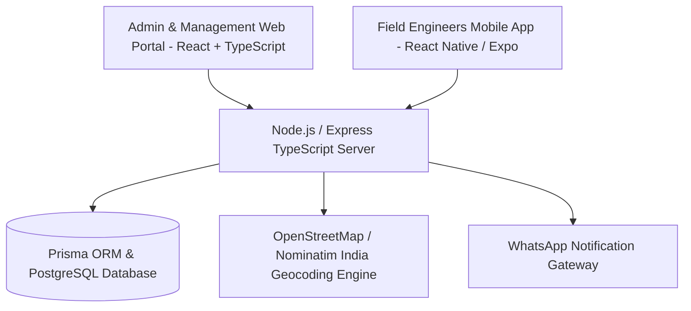
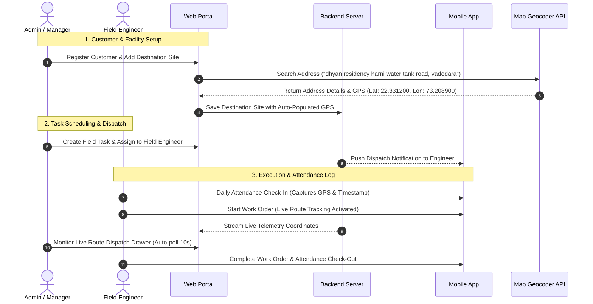

# Taneja Power CRM & Field Workforce Management System
## Comprehensive Technical & Functional Documentation

---

## 1. Executive Summary & Vision

**Taneja Power CRM** is an enterprise-grade Customer Relationship Management, Field Dispatch, and Telemetry Monitoring platform designed for industrial power, heavy engineering, and energy equipment service operations. 

The system unifies:
- **Enterprise Web Portal (`client/`)**: Comprehensive Web UI for Administrators and Operational Managers to manage staff, clients, multi-facility destination sites, lead pipelines, field dispatches, attendance logs, and telemetry.
- **Field Workforce Mobile App (`sales-app/`)**: Native mobile experience for field engineers and sales representatives to execute dispatches, record real-time GPS check-ins/outs, and access site specifications on the go.
- **RESTful Telemetry & API Server (`server/`)**: Scalable backend handling authentication, geocoding pipelines, work order state machines, and live GPS route tracking streams.

---

## 2. Technology Stack Architecture



### Core Technologies
- **Web Frontend**: React 18, TypeScript, Tailwind CSS, Lucide Icons, React Query, Zustand State Management, React Router.
- **Mobile Sales App**: React Native, Expo, TypeScript, React Navigation, Geolocation API.
- **Backend Server**: Node.js, Express.js, TypeScript, Prisma ORM, PostgreSQL.
- **Geocoding & Maps**: OpenStreetMap Nominatim Engine (restricted to India `countrycodes=in` with multi-tier landmark fallback).
- **Authentication**: JWT-based session tokens with role-based access control (`ADMIN` vs `EMPLOYEE`).

---

## 3. End-to-End System & User Workflows



---

## 4. Detailed Component & Feature Flow

### 4.1. Authentication & Session Verification Flow
- **Route Guard**: Every protected web page is wrapped with `<ProtectedRoute>`.
- **Preloader UI**: Displays a centered, dark-themed preloader featuring the official **Taneja Power logo** (`/logo.png`) with an animated gradient spinner ring and security validation status (`"Verifying authentication session..."`).
- **Role Routing**:
  - `ADMIN` role defaults to `/admin/dashboard`.
  - `EMPLOYEE` role defaults to `/employee/dashboard`.

---

### 4.2. Customer & Multi-Facility Destination Management
- **Enterprise Client Accounts**: Register corporate clients with primary contact details, phone, email, and billing address.
- **Multi-Facility Destinations**: Add multiple factory sites, turbine units, or field locations under a single customer.
- **India-Only Map Geocoding Autocomplete**:
  - When typing in the **Facility Address** field, the modal executes debounced queries (400ms) restricted to India (`countrycodes=in`).
  - **Sanitization & Landmark Fallback**: Strips filler prepositions (`near`, `opp`, `opposite`, `behind`, `landmark`) and uses a 4-tier fallback algorithm (Nominatim + Photon API) so queries like `"dhyan residency near harni water tank road, vadodara"` reliably match **Harni Water Tank Road, Vadodara, Gujarat**.
  - **Auto-GPS Population**: Selecting a suggestion automatically populates **Latitude**, **Longitude**, **City**, **State**, and **Pincode** fields.

---

### 4.3. Field Task & Dispatch Management
- **Work Order Lifecycle**: `CREATED` ➔ `ASSIGNED` ➔ `IN_PROGRESS` ➔ `COMPLETED` / `CANCELLED`.
- **Responsive Task Table**:
  - **Desktop View (`≥ 768px`)**: Full-width fixed layout (`md:table-fixed`) displaying Task Title, Customer & Site, Engineer, Priority, Status, Scheduled Date, and Actions cleanly without horizontal scrollbars.
  - **Mobile View (`< 768px`)**: Smooth horizontal scrolling (`overflow-x-auto min-w-[800px]`) ensuring un-squashed badge text and touchable controls.
- **Live Route Tracking Drawer**:
  - Portalled into `document.body` with `z-[100]`.
  - Displays real-time GPS distance calculations (straight-line km/meters) between engineer live position and target destination site.
  - Auto-polls telemetry every 10 seconds.
  - Dismissible via close button (`X`) or by clicking anywhere on the background overlay.

---

### 4.4. Employee Attendance System
- **Employee View (`/employee/attendance`)**:
  - Live IST Clock & Shift Status Banner.
  - One-tap **Check-In / Check-Out** with mandatory browser/mobile GPS geolocation capture.
  - Active duty session timer & work note entry.
- **Admin View (`/admin/attendance`)**:
  - Attendance metrics (Checked-in personnel, on-time percentage, completed duty hours).
  - Detailed side drawer (`AttendanceDetailModal`) showing verified server timestamps, latitude/longitude coordinates with one-click copy, and total computed duty duration.

---

### 4.5. Deals Pipeline & Lead Management
- **Kanban Board**: Drag-and-drop or status-card progression for sales leads across pipeline stages (`New`, `Contacted`, `Qualified`, `Proposal Sent`, `Negotiation`, `Won/Lost`).
- **Lead Drawers**: Slide-over right-to-left drawers (`LeadDrawer.tsx`) portalled at `z-[100]` for editing lead specifications, budget, and follow-up activities.

---

## 5. Directory Structure & Key Code References

```
Taneja-Power-CRM/
├── client/                               # Admin & Operations Web Portal
│   ├── public/logo.png                   # Official Company Logo
│   └── src/
│       ├── app/router/                   # SPA Navigation & Route Redirects
│       ├── components/layout/
│       │   ├── Header.tsx                # Sticky top navbar with user profile
│       │   ├── Sidebar.tsx               # Brand header & role navigation
│       │   ├── Layout.tsx                # Main application frame
│       │   └── ProtectedRoute.tsx        # Preloader with company logo
│       ├── features/
│       │   ├── admin/                    # Employee Management & Admin Analytics
│       │   ├── attendance/               # Employee Attendance & Duty Drawer
│       │   ├── customers/                # Customer & Destination Geocoding
│       │   │   ├── components/DestinationModal.tsx  # Map Autocomplete & Auto-GPS
│       │   │   └── components/DestinationsDrawer.tsx # Facility Sites Drawer
│       │   ├── employee/                 # Employee Personal Portal & Check-In
│       │   ├── leads/                    # Leads & Kanban Deals Pipeline
│       │   ├── tasks/                    # Field Work Orders & Live Tracking
│       │   │   ├── components/TaskTable.tsx # Responsive Task Table
│       │   │   └── components/LiveRouteTrackingDrawer.tsx # Live GPS Dispatch
│       │   └── whatsapp/                 # WhatsApp Alert Notification Gateway
├── sales-app/                            # Mobile Sales & Field Engineer App
│   └── src/                              # React Native UI Screens & GPS Capture
└── server/                               # Backend REST API Server
    ├── prisma/                           # Database Schema & Migrations
    └── src/controllers/                  # Route Controllers & Services
```

---

## 6. Development & Deployment Guide

### Local Development Setup
1. **Start Backend Server**:
   ```bash
   cd server
   npm run dev
   ```
2. **Start Web Client Portal**:
   ```bash
   cd client
   npm run dev
   ```
3. **Start Mobile Sales App**:
   ```bash
   cd sales-app
   npx expo start
   ```

### Code Quality Verification
Run TypeScript validation across the web portal:
```bash
cd client
npx tsc --noEmit
```

---

*Document compiled for Taneja Power System - Version 2.4.0*
