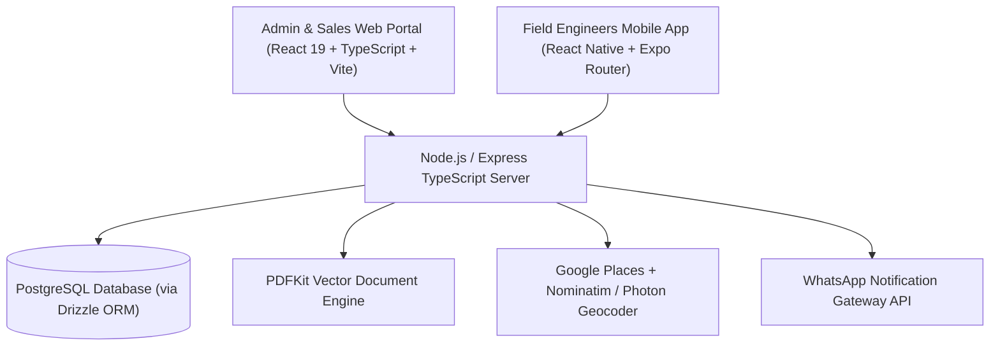
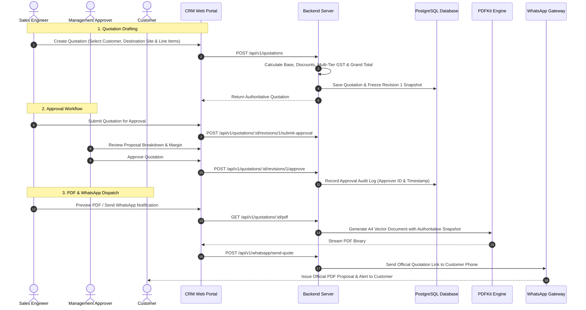

# Taneja Power CRM & Enterprise Engineering Management System
## Comprehensive Technical & Functional Project Documentation

---

## 1. Executive Summary & Vision

**Taneja Power CRM** is an enterprise-grade platform combining Customer Relationship Management (CRM), an authoritative Commercial & Technical Quotation Engine, Multi-Facility Field Workforce Telemetry, Heavy Equipment Field Service Operations, Annual Maintenance Contracts (AMC), and WhatsApp Customer Engagement.

The system is tailored for industrial heavy engineering, power generation, substations, and energy equipment manufacturing. It unifies:

- **Enterprise Web Portal (`client/`)**: Modern React 19 web application for Executives, Sales Engineers, Operations Managers, and Field Supervisors to create quotations, manage AMC revisions, trigger multi-tier approval workflows, stream vector PDFs, dispatch field engineers, track service reports, and monitor telemetry.
- **RESTful API & Calculation Engine (`server/`)**: Robust Express TypeScript backend with Drizzle ORM, PostgreSQL database, authoritative multi-tier GST tax engines, sequential numbering services, vector PDF generation pipelines, and WhatsApp integration gateway.
- **Field Workforce Mobile App (`sales-app/`)**: Native mobile application built with React Native and Expo Router for field engineers and sales representatives to execute service dispatches, capture GPS attendance, manage customer visits, and complete field engineering reports.

---

## 2. Technology Stack Architecture



### Core Technologies
- **Web Frontend**: React 19, TypeScript, Vite, Tailwind CSS v4, Lucide Icons, TanStack Query (React Query v5), Zustand, React Router v6.
- **Backend Server**: Node.js, Express.js, TypeScript, Drizzle ORM, PostgreSQL (`pg`), Zod validation schemas.
- **Document Engine**: PDFKit with dynamic page buffering, multi-page layout engine, and vector graphic formatting.
- **Geocoding & Maps**: Multi-tier pipeline combining Google Places API with OpenStreetMap Nominatim and Komoot Photon fallback engines.
- **Mobile Sales App**: React Native, Expo (SDK 52), Expo Router v4, TypeScript, Geolocation API.
- **Messaging Gateway**: WhatsApp API gateway for automated notification dispatch and proposal link delivery.
- **Authentication**: JWT access tokens + HTTP-only Refresh Token rotation with Role-Based Access Control (`ADMIN`, `MANAGER`, `SALES`, `ENGINEER`).

---

## 3. End-to-End System & User Workflows



---

## 4. Comprehensive Functional Modules

### 4.1. Commercial Quotations & Proposals Engine
- **Quotation Categories**:
  - `PRODUCT`: Heavy machinery, diesel generators, switchgear panels, transformers.
  - `TECHNICAL`: Custom engineering turnkey packages with in-depth technical specifications.
  - `SERVICE`: On-site testing, installation, commissioning, harmonic analysis.
  - `AMC`: Annual Maintenance Contracts with service visit schedules.
- **Authoritative Multi-Tier GST Engine**:
  - Supports mixed GST rates per line item (0%, 5%, 12%, 18%, 28%).
  - Automatically identifies Intra-State (Gujarat $\rightarrow$ Gujarat: CGST + SGST) versus Inter-State (Gujarat $\rightarrow$ Other States: IGST).
  - Authoritative document rounding and Indian Numbering **Amount in Words** formatting.
- **Immutable Revision Snapshot Pattern**:
  - When revisions are created (`Rev 1`, `Rev 2`, `Rev N`), all customer metadata, prices, discounts, taxes, and commercial terms are permanently frozen. Master catalog price updates never alter historical proposals.
- **Multi-Tier Approval State Machine**:
  - `DRAFT` $\rightarrow$ `PENDING_APPROVAL` $\rightarrow$ `APPROVED` / `REJECTED` $\rightarrow$ `SENT` $\rightarrow$ `ACCEPTED` / `REJECTED_BY_CUSTOMER`.
  - Enforces role-based permissions (only Managers and Admins can approve high-value proposals).
- **Production-Ready PDF & Print Studio**:
  - In-browser live PDF stream preview modal with zoom, download, and print capabilities.
  - Pixel-perfect vector A4 layout with dynamic multi-page numbering (`Page X of Y`), repeating table headers, and dedicated technical specification scopes.
  - Clean status-guarded signature blocks: Approved quotations display official review timestamps and approver names; drafts display unapproved proposal indicators.

---

### 4.2. Customer & Multi-Facility Destination Management
- **Enterprise Client Directory**: Manage corporate client accounts, legal entity names, GSTIN, PAN, and billing addresses.
- **Multi-Facility Destinations**: Add multiple factory sites, thermal power plants, or field locations under a single customer account.
- **India-Only Map Geocoding Autocomplete**:
  - Real-time address autocomplete powered by Google Places with Nominatim and Photon fallbacks.
  - Automatic population of **Latitude**, **Longitude**, **City**, **State**, and **Pincode**.
  - Interactive OpenStreetMap Leaflet map preview embedded directly in the creation modal.

---

### 4.3. Field Task & Telemetry Dispatch Management
- **Work Order Lifecycle**: `CREATED` $\rightarrow$ `ASSIGNED` $\rightarrow$ `IN_PROGRESS` $\rightarrow$ `COMPLETED` / `CANCELLED`.
- **Responsive Task Table**: Full-width desktop layout with horizontal touch scrolling on mobile devices.
- **Live Route Tracking Drawer**:
  - Real-time GPS distance calculation between engineer live position and target facility site.
  - Auto-polls live telemetry coordinates every 10 seconds.

---

### 4.4. Employee Attendance System
- **Employee View (`/employee/attendance`)**:
  - Live IST clock and shift status banner.
  - One-tap check-in and check-out with mandatory browser/mobile GPS capture.
- **Admin View (`/admin/attendance`)**:
  - Shift analytics (on-time percentage, active on-duty personnel, completed hours).
  - Detailed side drawer showing verified server timestamps and GPS coordinates with one-click copy.

---

### 4.5. Deals Pipeline & Product Catalog
- **Deals Kanban Board**: Drag-and-drop sales opportunities across stages (`New`, `Contacted`, `Qualified`, `Proposal Sent`, `Negotiation`, `Won/Lost`).
- **Product & Price Master**: Catalog of engineering equipment, standardized SKUs, unit rates, HSN/SAC codes, and default GST rates.

---

### 4.6. Annual Maintenance Contracts (AMC)
- **Contract Lifecycle**: Draft, Active, Expiring, Renewed, Cancelled contracts tracking.
- **Service Schedule Management**: Automatic generation of routine maintenance visits (Quarterly, Semi-Annual, Annual).
- **Asset Coverage Catalog**: Specific equipment serial numbers, generator ratings, and transformer capacities covered under contract.
- **Expiration Alerts**: Automated dashboard reminders for contracts nearing renewal dates.

---

### 4.7. Field Service Engineering Operations
- **On-Site Service Job Management**: Breakdown service requests, preventive maintenance visits, and installation commissioning dispatches.
- **Field Engineering Reports**: Digital job cards capturing fault diagnosis, replaced spares, technician observations, and customer sign-off.
- **Mobile Integration**: Service engineers access assigned field service orders directly on the mobile app (`sales-app`).

---

### 4.8. WhatsApp Notification Gateway
- **Automated Messaging**: Dispatch quotation preview links, approval alerts, and appointment reminders directly to customer phone numbers.
- **Delivery Status Logs**: Server-side tracking of message delivery status and dispatch logs.

---

### 4.9. Enterprise Authentication & Security
- **JWT & Session Security**: Short-lived access tokens coupled with secure refresh token rotation (`refreshTokens` database table).
- **Role-Based Authorization**: Strict route guards enforcing `ADMIN`, `MANAGER`, `SALES`, and `ENGINEER` permissions on both frontend and backend API.
- **Customizable Auth UI**: High-contrast modern interface with brand showcase panel and quick role access toggles.

---

## 5. Directory Structure & Key Code References

```
Taneja-Power-CRM/
├── client/                               # Enterprise Web Portal (React 19 + TS + Vite)
│   ├── public/logo.png                   # Official Company Logo Asset
│   └── src/
│       ├── app/                          # API Client, Router, Config
│       ├── components/                   # Shared UI Components (Header, Sidebar, Modals)
│       └── features/
│           ├── admin/                    # Admin Dashboard & User Operations
│           ├── amc-contracts/            # AMC Management & Service Visit Schedules
│           ├── attendance/               # Employee GPS Attendance & Shift Logs
│           ├── auth/                     # Authentication, Login Page & Brand Panel
│           ├── customers/                # Customer Directory & Destination Modals
│           ├── employee/                 # Employee Views & Shift Controls
│           ├── field-service/            # Field Service Job Cards & Reports
│           ├── leads/                    # Sales Opportunities & Kanban Pipeline
│           ├── products/                 # Product Catalog & Price Master
│           ├── profile/                  # User Profile & Security Settings
│           ├── quotations/               # Complete Commercial & Technical Quotation Engine
│           ├── tasks/                    # Work Order Dispatches & Live Telemetry Tracking
│           └── whatsapp/                 # WhatsApp Notification Dispatch Gateway
├── server/                               # Backend REST API Server (Node.js + TS + Express)
│   ├── drizzle/                          # Drizzle SQL Migrations & Snapshots
│   └── src/
│       ├── database/
│       │   ├── schema/                   # Drizzle ORM Database Schemas
│       │   │   ├── amc-contracts.ts      # AMC Contracts & Service Schedules
│       │   │   ├── attendance.ts         # Attendance & GPS Coordinates
│       │   │   ├── customers.ts          # Customers & Destinations
│       │   │   ├── field-service.ts      # Service Orders & Spares Logs
│       │   │   ├── leads.ts              # Sales Deals Pipeline
│       │   │   ├── products.ts           # Product Master Catalog
│       │   │   ├── quotations.ts         # Quotations, Revisions & Line Items
│       │   │   ├── refreshTokens.ts      # Auth Refresh Tokens
│       │   │   ├── tasks.ts              # Work Orders & Dispatch Tasks
│       │   │   └── users.ts              # Users & Role Authorization
│       │   └── test-quotation-pdf.ts     # Automated PDF Unit & Integration Test Suite
│       └── modules/
│           ├── amc-contracts/            # AMC Business Logic & Routes
│           ├── attendance/               # Attendance & GPS Logs Controller
│           ├── auth/                     # JWT Authentication & Role Guards
│           ├── customers/                # Customer & Facility Destination Services
│           ├── employees/                # Employee Management API
│           ├── field-service/            # Field Engineering Service Module
│           ├── geocoding/                # Multi-Provider Geocoding Orchestrator
│           ├── leads/                    # Leads & Sales Pipeline API
│           ├── products/                 # Product Catalog API
│           ├── quotations/               # Commercial Quotation Module & PDF Engine
│           ├── tasks/                    # Work Order & Telemetry Dispatch Services
│           └── whatsapp/                 # WhatsApp Gateway Integration Module
└── sales-app/                            # Field Engineer & Sales Representative Mobile App (Expo)
    ├── app/                              # Expo Router v4 File-based Route Handlers
    │   ├── (app)/                        # Authenticated App Tab Routes
    │   │   ├── (tabs)/                   # Home, Customer, Service & Task Tabs
    │   │   ├── attendance/               # Mobile GPS Attendance Clock
    │   │   ├── customers/                # Customer Site Details & Map View
    │   │   ├── field-service/            # On-site Engineering Job Cards
    │   │   └── tasks/                    # Assigned Dispatches & Route Telemetry
    │   └── (auth)/                       # Mobile Authentication Screens
    └── src/                              # Shared Mobile Services, API Clients, Theme & Hooks
```

---

## 6. Development, Testing & Verification Guide

### Local Development Setup
1. **Start Backend Server**:
   ```bash
   cd server
   npm run dev
   ```
2. **Start Web Client Portal**:
   ```bash
   cd client
   npm run dev
   ```
3. **Start Mobile Sales App**:
   ```bash
   cd sales-app
   npx expo start
   ```

### Quality & Compilation Verification
- **Run Backend Typecheck**:
  ```bash
  cd server
  npx tsc --noEmit
  ```
- **Run Quotation PDF Automated Test Suite**:
  ```bash
  cd server
  npx tsx src/database/test-quotation-pdf.ts
  ```
- **Run Frontend Production Build**:
  ```bash
  cd client
  npm run build
  ```

---

*Document compiled for Taneja Power System — Version 3.0.0 (Production-Ready Release)*
