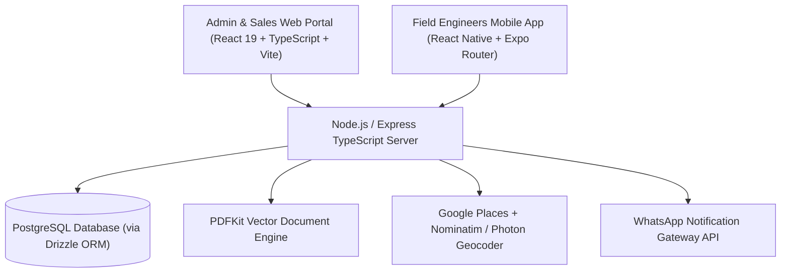
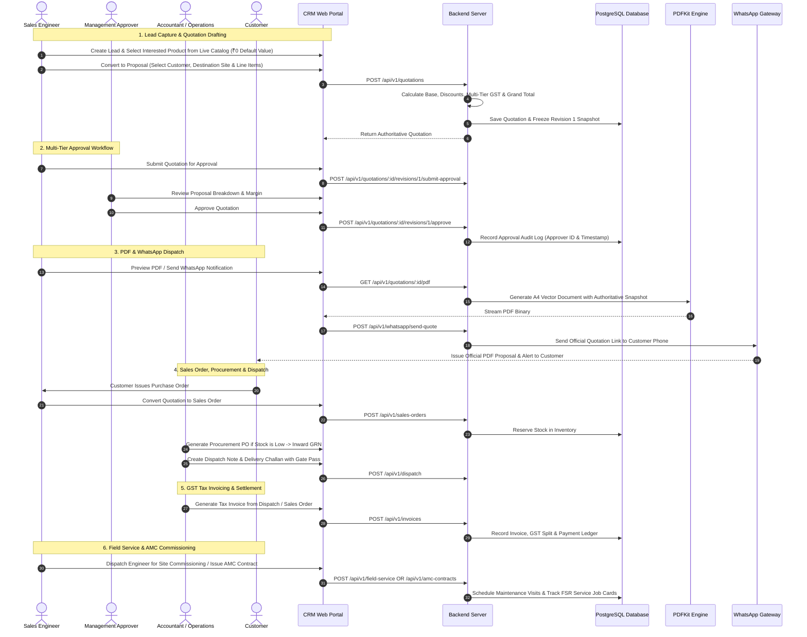

# Taneja Power CRM & Enterprise Engineering Management System
## Comprehensive Technical & Functional Project Documentation

---

## 1. Executive Summary & Vision

**Taneja Power CRM** is an enterprise-grade engineering management platform combining Customer Relationship Management (CRM), an authoritative Commercial & Technical Quotation Engine, Sales Order Processing, Procurement & Vendor Management, Inventory & Stock Movement, Dispatch & Delivery Challans, Invoicing & Financial Ledgers, Multi-Facility Field Workforce Telemetry, Heavy Equipment Field Service Operations (FSR), Annual Maintenance Contracts (AMC), and WhatsApp Customer Engagement.

The system is engineered for industrial heavy engineering, power generation, substations, transformer manufacturing, and energy equipment distribution. It unifies:

- **Enterprise Web Portal (`client/`)**: Modern React 19 web application for Executives, Sales Engineers, Operations Managers, Accountants, and Field Supervisors to manage leads, generate multi-tier quotations, execute approval lifecycles, stream vector PDFs, process sales orders, track procurement GRNs, manage warehouse inventory, issue delivery challans, generate GST tax invoices, dispatch field engineers, and monitor real-time telemetry.
- **RESTful API & Calculation Engine (`server/`)**: Robust Express TypeScript backend with Drizzle ORM, PostgreSQL database, authoritative multi-tier GST tax engines, sequential numbering services (QT, SO, INV, FSR, PO), vector PDF generation pipelines, and WhatsApp notification gateway.
- **Field Workforce Mobile App (`sales-app/`)**: Native mobile application built with React Native and Expo Router for field engineers and sales representatives to execute service dispatches, capture verified GPS attendance, manage customer visits, and complete on-site field engineering job cards.

---

## 2. Technology Stack Architecture



### Core Technologies
- **Web Frontend**: React 19, TypeScript, Vite, Tailwind CSS, Lucide Icons, TanStack Query (React Query v5), Zustand, React Router v6.
- **Backend Server**: Node.js, Express.js, TypeScript, Drizzle ORM, PostgreSQL (`pg`), Zod validation schemas.
- **Document Engine**: PDFKit with dynamic page buffering, multi-page layout engine, and vector graphic formatting.
- **Geocoding & Maps**: Multi-tier pipeline combining Google Places API with OpenStreetMap Nominatim and Komoot Photon fallback engines.
- **Mobile Sales App**: React Native, Expo (SDK 52), Expo Router v4, TypeScript, Geolocation API.
- **Messaging Gateway**: WhatsApp API gateway for automated notification dispatch and proposal link delivery.
- **Authentication**: JWT access tokens + HTTP-only Refresh Token rotation with Role-Based Access Control (`ADMIN`, `MANAGER`, `USER`, `ACCOUNTANT`, `SALES`, `ENGINEER`).

---

## 3. End-to-End System & User Workflows



---

## 4. Comprehensive Functional Modules

### 4.1. Leads Management & Deals Pipeline (`leads/`)
- **Lead Intake**: Capture customer inquiries across Web, Referral, Field Call, Exhibition, and Direct channels.
- **Live Product Catalog Integration**: Dynamically select products directly from the live product master (with SKU details) instead of static values.
- **Expected Deal Value**: Defaults cleanly to **₹0** initially and allows precise numeric updates.
- **Interactive Kanban Pipeline**: Drag-and-drop opportunity progression across sales stages (`New`, `Contacted`, `Qualified`, `Proposal Sent`, `Negotiation`, `Won/Lost`).
- **Entity Follow-ups**: Schedule automated follow-up reminders directly linked to specific leads and deals.

### 4.2. Commercial Quotations & Proposals Studio (`quotations/`)
- **Quotation Categories**:
  - `PRODUCT`: Standard equipment, transformers, switchgears, and instruments.
  - `TECHNICAL`: Custom engineering packages with detailed scopes and technical specifications.
  - `SERVICE`: On-site testing, installation, harmonic studies, and commissioning.
  - `AMC`: Comprehensive Annual Maintenance Contracts with scheduled service visits.
- **Authoritative Multi-Tier GST Engine**:
  - Mixed GST rates per line item (0%, 5%, 12%, 18%, 28%).
  - Auto-detection of Intra-State (CGST + SGST) vs Inter-State (IGST) based on customer and company state codes.
  - Exact roundoff and Indian Numbering **Amount in Words** legal engine.
- **Immutable Revision Snapshot Pattern**:
  - Every proposal revision (`Rev 1`, `Rev 2`, `Rev N`) freezes all customer details, items, prices, and terms.
  - Revisions branch cleanly without modifying historical audit records.
- **Approval Lifecycle**: `DRAFT` $\rightarrow$ `PENDING_APPROVAL` $\rightarrow$ `APPROVED` / `REJECTED` $\rightarrow$ `SENT` $\rightarrow$ `ACCEPTED` / `REJECTED_BY_CUSTOMER`.
- **Vector PDF & Print Studio**: Streaming PDFKit engine with multi-page numbering (`Page X of Y`), repeating headers, dynamic signatures, and high-resolution `@media print` layout.

### 4.3. Sales Orders Subsystem (`sales-orders/`)
- **Order Conversion**: Convert accepted commercial quotations into official sales orders with one click.
- **Item Snapshots & Delivery Tracking**: Preserve ordered item specifications, delivery timelines, and shipment milestones.
- **Inventory Integration**: Automatic checking of warehouse availability and stock reserve allocations.

### 4.4. Procurement & Vendor Management (`procurement/`)
- **Vendor Master**: Centralized vendor directory with GSTIN, contact details, payment terms, and ratings.
- **Purchase Orders (PO)**: Generate formal procurement purchase orders against low stock or project requirements.
- **Material Inward & GRN**: Goods Receipt Note (GRN) workflow verifying received quantities, batch details, and inspection remarks.

### 4.5. Inventory & Stock Movement (`inventory/`)
- **Real-Time Stock Levels**: Track available, reserved, and defective equipment counts across warehouses.
- **Stock Movement Ledger**: Complete audit trail of stock inward (GRN), outward (Dispatch), adjustments, and returns.

### 4.6. Dispatch, Delivery Challan & Gate Pass (`dispatch/`)
- **Dispatch Notes**: Generate packing lists and dispatch records against open sales orders.
- **Delivery Challan & Gate Pass**: Issue official transport challans with carrier details, vehicle registration numbers, and driver contact info.
- **Status Progression**: Track dispatches from `PREPARED` $\rightarrow$ `DISPATCHED` $\rightarrow$ `DELIVERED`.

### 4.7. Invoicing & Accountant Ledger (`invoices/`, `accountant/`)
- **GST Tax Invoices**: Generate legally compliant GST invoices from sales orders or dispatches.
- **Payment Reconciliation**: Track payment milestones (`UNPAID`, `PARTIAL`, `PAID`) and record transaction references.
- **Accountant Dashboard**: Real-time financial overview of receivables, payables, tax liabilities, and sales velocity.

### 4.8. Customer & Multi-Facility Destination Management (`customers/`)
- **Enterprise Client Directory**: Manage corporate client accounts, GSTIN, PAN, and billing addresses.
- **Multi-Facility Destinations**: Add multiple factory plants or substation field locations under a single customer.
- **India Address Geocoding Autocomplete**: Real-time address resolution powered by Google Places with Nominatim and Photon fallbacks, with embedded OpenStreetMap Leaflet previews.

### 4.9. Field Service Engineering Operations (`field-service/`)
- **On-Site Service Job Management**: Breakdown emergency calls, preventive maintenance, and commissioning dispatches.
- **Field Service Reports (FSR)**: Digital job cards capturing fault diagnosis, replaced spare parts, technician observations, and customer sign-off.
- **Mobile Integration**: Service engineers access assigned service orders directly on the mobile app (`sales-app`).

### 4.10. Annual Maintenance Contracts (`amc-contracts/`)
- **Contract Lifecycle**: Track Draft, Active, Expiring, Renewed, and Cancelled maintenance contracts.
- **Service Schedule Management**: Automatic generation of routine maintenance visits (Quarterly, Semi-Annual, Annual).
- **Asset Coverage Catalog**: Specific equipment serial numbers, ratings, and transformer capacities covered under contract.
- **Service Report Linkage**: Execute maintenance visits and attach detailed AMC service reports.

### 4.11. Field Task & Telemetry Dispatch (`tasks/`)
- **Work Order Lifecycle**: `CREATED` $\rightarrow$ `ASSIGNED` $\rightarrow$ `IN_PROGRESS` $\rightarrow$ `COMPLETED` / `CANCELLED`.
- **Live Route Tracking Drawer**: Real-time GPS distance calculation between engineer live position and target facility site, auto-polling telemetry every 10 seconds.

### 4.12. Follow-Up Reminders & Scheduler (`follow-ups/`)
- **Entity Linking**: Associate scheduled follow-ups directly to Leads, Quotations, Sales Orders, or AMC Contracts.
- **Priority & Status Tracking**: Set priority levels (`Low`, `Medium`, `High`, `Urgent`) and track pending vs completed actions.

### 4.13. Employee Portal & Attendance Telemetry (`attendance/`, `employee/`)
- **Employee View (`/employee/attendance`)**: Live IST clock, shift status, and one-tap check-in/check-out with mandatory GPS capture.
- **Admin View (`/admin/attendance`)**: Shift analytics, on-time percentage, active on-duty personnel, and verified GPS coordinates drawer.

### 4.14. Products & Pricing Master (`products/`)
- **Master Engineering Catalog**: Manage products, SKUs, model numbers, unit prices, technical specifications, and category classifications.

### 4.15. WhatsApp Notification Gateway (`whatsapp/`)
- **Automated Messaging**: Dispatch quotation preview links, approval alerts, and appointment reminders directly to customer phone numbers.
- **Dispatch Logs**: Server-side tracking of message delivery status and communication history.

### 4.16. Admin & Role Security Management (`admin/`, `auth/`, `profile/`)
- **Role-Based Authorization**: Strict route guards enforcing `ADMIN`, `MANAGER`, `USER`, `ACCOUNTANT`, `SALES`, and `ENGINEER` permissions.
- **JWT & Session Security**: Access tokens paired with secure cryptographic refresh token rotation.

---

## 5. Directory Structure & Key Code References

```
Taneja-Power-CRM/
├── client/                               # Enterprise Web Portal (React 19 + TS + Vite)
│   ├── public/logo.png                   # Official Company Logo Asset
│   └── src/
│       ├── app/                          # API Client, Router, Config & Providers
│       ├── components/                   # Shared UI Components (Table, StatusPill, Modals, Cards, Toast)
│       ├── stores/                       # Zustand Global State Stores (authStore, productStore)
│       └── features/
│           ├── accountant/               # Accountant Dashboard & Financial Ledger
│           ├── admin/                    # Admin Dashboard & User Operations
│           ├── amc-contracts/            # AMC Management & Service Visit Schedules
│           ├── attendance/               # Employee GPS Attendance & Shift Logs
│           ├── auth/                     # Authentication, Login & Brand Panel
│           ├── customers/                # Customer Directory & Destination Modals
│           ├── dispatch/                 # Dispatch Notes, Delivery Challans & Gate Passes
│           ├── employee/                 # Employee Views & Shift Controls
│           ├── field-service/            # Field Service Job Cards & FSR Reports
│           ├── follow-ups/               # Follow-Up Scheduler & Reminder Triggers
│           ├── inventory/                # Stock Reserves & Movement Ledger
│           ├── invoices/                 # GST Tax Invoices & Payment Tracking
│           ├── leads/                    # Sales Opportunities & Kanban Pipeline
│           ├── procurement/              # Vendor Directory, Purchase Orders & GRN
│           ├── products/                 # Product Catalog & Price Master
│           ├── profile/                  # User Profile & Security Settings
│           ├── quotations/               # Complete Commercial Quotation Studio & PDF Engine
│           ├── sales-orders/             # Sales Order Processing from Accepted Proposals
│           ├── tasks/                    # Work Order Dispatches & Live Telemetry Tracking
│           └── whatsapp/                 # WhatsApp Notification Dispatch Gateway
├── server/                               # Backend REST API Server (Node.js + TS + Express)
│   ├── drizzle/                          # Drizzle SQL Migrations & Snapshots
│   └── src/
│       ├── common/                       # Middleware, Auth Guards & Response Envelopes
│       ├── database/
│       │   ├── schema/                   # Drizzle ORM Database Schemas (17 Tables)
│       │   │   ├── amc-contracts.ts      # AMC Contracts & Service Schedules
│       │   │   ├── attendance.ts         # Attendance & GPS Coordinates
│       │   │   ├── customers.ts          # Customers & Destinations
│       │   │   ├── dispatch.ts           # Dispatch Notes & Items
│       │   │   ├── field-service.ts      # Service Orders & Spares Logs
│       │   │   ├── follow-ups.ts         # Follow-Up Schedules
│       │   │   ├── inventory.ts          # Stock Movement Ledger
│       │   │   ├── invoices.ts           # GST Tax Invoices & Payments
│       │   │   ├── leads.ts              # Sales Deals Pipeline
│       │   │   ├── procurement.ts        # Vendors, Purchase Orders & GRN
│       │   │   ├── products.ts           # Product Master Catalog
│       │   │   ├── quotations.ts         # Quotations, Revisions & Line Items
│       │   │   ├── refreshTokens.ts      # Auth Refresh Tokens
│       │   │   ├── sales-orders.ts       # Sales Orders & Items
│       │   │   ├── tasks.ts              # Work Orders & Dispatch Tasks
│       │   │   └── users.ts              # Users & Role Authorization
│       │   └── relations/                # Drizzle Entity Relationships
│       └── modules/
│           ├── amc-contracts/            # AMC Business Logic & Routes
│           ├── attendance/               # Attendance & GPS Logs Controller
│           ├── auth/                     # JWT Authentication & Role Guards
│           ├── customers/                # Customer & Facility Destination Services
│           ├── dispatch/                 # Dispatch & Delivery Challan Module
│           ├── employees/                # Employee Management API
│           ├── field-service/            # Field Engineering Service Module
│           ├── follow-ups/               # Follow-Up Scheduler API
│           ├── geocoding/                # Multi-Provider Geocoding Orchestrator
│           ├── inventory/                # Stock Movement & Warehouse API
│           ├── invoices/                 # GST Invoicing & Payment API
│           ├── leads/                    # Leads & Sales Pipeline API
│           ├── procurement/              # Procurement & Vendor Management API
│           ├── products/                 # Product Catalog API
│           ├── quotations/               # Commercial Quotation Module & PDF Engine
│           ├── sales-orders/             # Sales Order Processing Module
│           ├── tasks/                    # Work Order & Telemetry Dispatch Services
│           └── whatsapp/                 # WhatsApp Gateway Integration Module
└── sales-app/                            # Field Engineer & Sales Mobile App (Expo)
    ├── app/                              # Expo Router v4 File-based Route Handlers
    │   ├── (app)/                        # Authenticated App Tab Routes
    │   │   ├── (tabs)/                   # Home, Customer, Service & Task Tabs
    │   │   ├── attendance/               # Mobile GPS Attendance Clock
    │   │   ├── customers/                # Customer Site Details & Map View
    │   │   ├── field-service/            # On-site Engineering Job Cards
    │   │   └── tasks/                    # Assigned Dispatches & Route Telemetry
    │   └── (auth)/                       # Mobile Authentication Screens
    └── src/                              # Shared Mobile Services, API Clients, Theme & Hooks
```

---

## 6. Development, Testing & Verification Guide

### Local Development Setup
1. **Start Backend Server**:
   ```bash
   cd server
   npm run dev
   ```
2. **Start Web Client Portal**:
   ```bash
   cd client
   npm run dev
   ```
3. **Start Mobile Sales App**:
   ```bash
   cd sales-app
   npx expo start
   ```

### Quality & Compilation Verification
- **Run Backend Typecheck**:
   ```bash
   cd server
   npx tsc --noEmit
   ```
- **Run Quotation PDF Automated Test Suite**:
   ```bash
   cd server
   npx tsx src/database/test-quotation-pdf.ts
   ```
- **Run Frontend Production Build**:
   ```bash
   cd client
   npm run build
   ```

---

*Document compiled for Taneja Power System — Version 3.1.0 (Production-Ready Release)*
