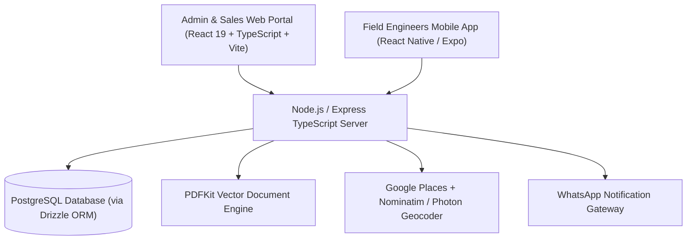
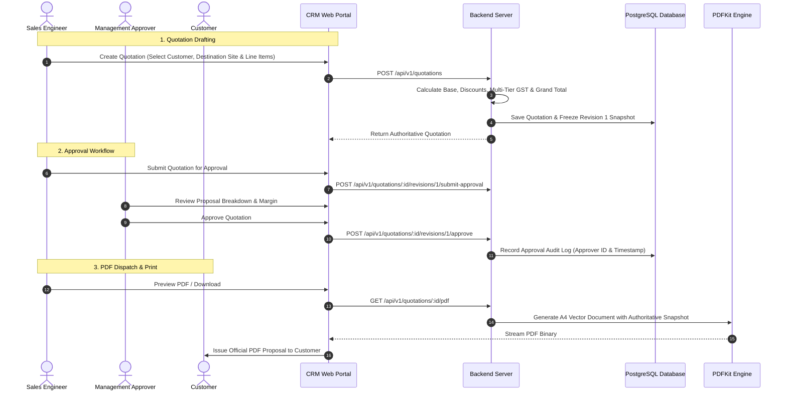

# Taneja Power CRM & Enterprise Engineering Management System
## Comprehensive Technical & Functional Project Documentation

---

## 1. Executive Summary & Vision

**Taneja Power CRM** is an enterprise-grade platform combining Customer Relationship Management (CRM), an authoritative Commercial & Technical Quotation Engine, Multi-Facility Field Workforce Telemetry, and Heavy Equipment Service Operations.

The system is tailored for industrial heavy engineering, power generation, substations, and energy equipment manufacturing. It unifies:

- **Enterprise Web Portal (`client/`)**: Modern React 19 web application for Executives, Sales Engineers, and Operations Managers to create quotations, manage revisions, trigger approval workflows, stream PDFs, dispatch field engineers, and monitor telemetry.
- **RESTful API & Calculation Engine (`server/`)**: Robust Express TypeScript backend with Drizzle ORM, authoritative multi-tier GST tax engines, sequential numbering services, and vector PDF generation pipelines.
- **Field Workforce Mobile App (`sales-app/`)**: Native mobile application for field engineers and sales representatives to execute dispatches, capture GPS attendance, and view facility destination specs.

---

## 2. Technology Stack Architecture



### Core Technologies
- **Web Frontend**: React 19, TypeScript, Vite, Tailwind CSS, Lucide Icons, TanStack Query (React Query v5), Zustand, React Router v6.
- **Backend Server**: Node.js, Express.js, TypeScript, Drizzle ORM, PostgreSQL (`pg`), Zod validation schemas.
- **Document Engine**: PDFKit with dynamic page buffering, multi-page layout engine, and vector graphic formatting.
- **Geocoding & Maps**: Multi-tier pipeline combining Google Places API with OpenStreetMap Nominatim and Komoot Photon fallback engines.
- **Mobile Sales App**: React Native, Expo, TypeScript, React Navigation, Geolocation API.
- **Authentication**: JWT-based session tokens with role-based access control (`ADMIN`, `MANAGER`, `SALES`, `ENGINEER`).

---

## 3. End-to-End System & User Workflows



---

## 4. Comprehensive Functional Modules

### 4.1. Commercial Quotations & Proposals Engine
- **Quotation Categories**:
  - `PRODUCT`: Heavy machinery, diesel generators, switchgear panels, transformers.
  - `TECHNICAL`: Custom engineering turnkey packages with in-depth technical specifications.
  - `SERVICE`: On-site testing, installation, commissioning, harmonic analysis.
  - `AMC`: Annual Maintenance Contracts with service visit schedules.
- **Authoritative Multi-Tier GST Engine**:
  - Supports mixed GST rates per line item (0%, 5%, 12%, 18%, 28%).
  - Automatically identifies Intra-State (Gujarat $\rightarrow$ Gujarat: CGST + SGST) versus Inter-State (Gujarat $\rightarrow$ Other States: IGST).
  - Authoritative document rounding and Indian Numbering **Amount in Words** formatting.
- **Immutable Revision Snapshot Pattern**:
  - When revisions are created (`Rev 1`, `Rev 2`, `Rev N`), all customer metadata, prices, discounts, taxes, and commercial terms are permanently frozen. Master catalog price updates never alter historical proposals.
- **Multi-Tier Approval State Machine**:
  - `DRAFT` $\rightarrow$ `PENDING_APPROVAL` $\rightarrow$ `APPROVED` / `REJECTED` $\rightarrow$ `SENT` $\rightarrow$ `ACCEPTED` / `REJECTED_BY_CUSTOMER`.
  - Enforces role-based permissions (only Managers and Admins can approve high-value proposals).
- **Production-Ready PDF & Print Studio**:
  - In-browser live PDF stream preview modal with zoom, download, and print capabilities.
  - Pixel-perfect vector A4 layout with dynamic multi-page numbering (`Page X of Y`), repeating table headers, and dedicated technical specification scopes.
  - Clean status-guarded signature blocks: Approved quotations display official review timestamps and approver names; drafts display unapproved proposal indicators.

---

### 4.2. Customer & Multi-Facility Destination Management
- **Enterprise Client Directory**: Manage corporate client accounts, legal entity names, GSTIN, PAN, and billing addresses.
- **Multi-Facility Destinations**: Add multiple factory sites, thermal power plants, or field locations under a single customer account.
- **India-Only Map Geocoding Autocomplete**:
  - Real-time address autocomplete powered by Google Places with Nominatim and Photon fallbacks.
  - Automatic population of **Latitude**, **Longitude**, **City**, **State**, and **Pincode**.
  - Interactive OpenStreetMap Leaflet map preview embedded directly in the creation modal.

---

### 4.3. Field Task & Telemetry Dispatch Management
- **Work Order Lifecycle**: `CREATED` $\rightarrow$ `ASSIGNED` $\rightarrow$ `IN_PROGRESS` $\rightarrow$ `COMPLETED` / `CANCELLED`.
- **Responsive Task Table**: Full-width desktop layout with horizontal touch scrolling on mobile devices.
- **Live Route Tracking Drawer**:
  - Real-time GPS distance calculation between engineer live position and target facility site.
  - Auto-polls live telemetry coordinates every 10 seconds.

---

### 4.4. Employee Attendance System
- **Employee View (`/employee/attendance`)**:
  - Live IST clock and shift status banner.
  - One-tap check-in and check-out with mandatory browser/mobile GPS capture.
- **Admin View (`/admin/attendance`)**:
  - Shift analytics (on-time percentage, active on-duty personnel, completed hours).
  - Detailed side drawer showing verified server timestamps and GPS coordinates with one-click copy.

---

### 4.5. Deals Pipeline & Product Catalog
- **Deals Kanban Board**: Drag-and-drop sales opportunities across stages (`New`, `Contacted`, `Qualified`, `Proposal Sent`, `Negotiation`, `Won/Lost`).
- **Product & Price Master**: Catalog of engineering equipment, standardized SKUs, unit rates, HSN/SAC codes, and default GST rates.

---

## 5. Directory Structure & Key Code References

```
Taneja-Power-CRM/
├── client/                               # Admin & Sales Web Portal (React 19 + TS)
│   ├── public/logo.png                   # Official Company Logo Asset
│   └── src/
│       ├── app/                          # API Client, Router, Config
│       ├── components/                   # Shared UI Components (Header, Sidebar, Modals)
│       └── features/
│           ├── quotations/               # Complete Quotation Subsystem
│           │   ├── components/           # QuotationForm, Table, RevisionViewer, PDFModal, PrintDoc
│           │   ├── pages/                # ListPage, CreatePage, EditPage, DetailPage
│           │   ├── services/             # quotationService.ts (API client)
│           │   └── types/                # quotation.types.ts (Domain models)
│           ├── customers/                # Customer Directory & DestinationModal.tsx
│           ├── products/                 # Product Catalog & Price Master
│           ├── tasks/                    # Field Work Orders & Live Tracking
│           ├── attendance/               # Attendance & GPS Logs
│           └── leads/                    # Sales Pipeline & Kanban
├── server/                               # Backend REST API Server (Node.js + TS)
│   ├── drizzle/                          # Drizzle SQL Migrations
│   └── src/
│       ├── database/
│       │   ├── schema/                   # Drizzle Schemas (quotations.ts, customers.ts, etc.)
│       │   └── test-quotation-pdf.ts     # Automated PDF Unit & Integration Test Suite
│       └── modules/
│           ├── quotations/               # Quotation Backend Module
│           │   ├── controllers/          # quotation.controller.ts
│           │   ├── routes/               # quotation.routes.ts
│           │   ├── services/             # calculation, number, pdf, and quotation services
│           │   └── validators/           # quotation.validator.ts (Zod schemas)
│           ├── customers/                # Customer & Destination Services
│           ├── products/                 # Product Catalog API
│           ├── geocoding/                # Multi-Provider Geocoding Orchestrator
│           └── tasks/                    # Field Workforce Dispatch Module
└── sales-app/                            # Mobile Sales & Field Engineer App (Expo)
```

---

## 6. Development, Testing & Verification Guide

### Local Development Setup
1. **Start Backend Server**:
   ```bash
   cd server
   npm run dev
   ```
2. **Start Web Client Portal**:
   ```bash
   cd client
   npm run dev
   ```
3. **Start Mobile Sales App**:
   ```bash
   cd sales-app
   npx expo start
   ```

### Quality & Compilation Verification
- **Run Backend Typecheck**:
  ```bash
  cd server
  npx tsc --noEmit
  ```
- **Run Quotation PDF Automated Test Suite**:
  ```bash
  cd server
  npx tsx src/database/test-quotation-pdf.ts
  ```
- **Run Frontend Production Build**:
  ```bash
  cd client
  npm run build
  ```

---

*Document compiled for Taneja Power System — Version 3.0.0 (Production-Ready Release)*
