# Order Lifecycle Flow: Accountant & Admin Workflows

> **Document Purpose**: Comprehensive walkthrough of the end-to-end commercial order lifecycle—from initial lead qualification to final physical dispatch—detailing the exact division of responsibilities, permissions, and approval checkpoints between the **Accountant Office** role and the **Admin** role in Taneja Power CRM.

---

## 1. Executive Summary & Core Invariants

In the CRM architecture:
- **Sales & Admin** drive early client discovery, lead qualification, destination registration, and commercial quotation approval.
- **Accountant Office** serves as the commercial and financial operator responsible for converting accepted quotations into internal Sales Orders, calculating GST and issuing official Tax Invoices, recording payments, and drafting Delivery Challans.
- **Admin** maintains supreme fiduciary and inventory control: approving discount thresholds on quotations, confirming Sales Orders, authorizing vendor bills/PO approvals, and executing final physical dispatch authorization.

### Key Architectural Invariants
1. **Quotation Approval Gate**: A quotation can never be accepted or transformed into a Sales Order without prior Admin approval (`quotations:approve`).
2. **Sales Order Confirmation Gate**: An Accountant can draft and submit a Sales Order (`sales_order:create`, `sales_order:submit`), but **only Admin** can confirm or cancel it (`sales_order:confirm`, `sales_order:cancel`).
3. **No Premature Stock Mutation**: Neither Quotation creation, Sales Order confirmation, nor Tax Invoice issuance ever mutates warehouse stock quantities.
4. **Physical Dispatch Authorization**: An Accountant prepares the Delivery Challan and transport details (`dispatch:create`, `dispatch:submit`), but **only Admin / Store Manager** can execute final physical dispatch (`dispatch:dispatch`), at which exact moment central stock is deducted.
5. **Invoice Issuance Independence**: Tax Invoices can be issued by the Accountant against confirmed Sales Orders prior to or in tandem with dispatch, depending on payment terms.

---

## 2. Role & Permission Matrix: Accountant vs. Admin

| Feature Module | Accountant Office (`USER` + `Accountant Office`) | Admin (`ADMIN`) | Workflow Responsibility |
| :--- | :--- | :--- | :--- |
| **Leads & Pipeline** | **Read-Only** (`leads:view_all`) | **Full Access** (Create, Edit, Delete, Assign) | Sales/Admin qualify leads and register sites; Accountant views pipeline. |
| **Customer Directory** | **Read-Only** (`customers:read`) | **Full Access** (Create, Edit, Delete) | Accountant checks customer GSTIN, PAN, and billing/shipping sites. |
| **Service Destinations** | **Read-Only** | **Full Access** | Multi-facility sites mapped to customer accounts. |
| **Quotations & Pricing** | **Read-Only** (`quotations:view_all`) | **Full Access** + **Approve** (`quotations:approve`) | Admin approves commercial proposals; Accountant reviews accepted proposals. |
| **Sales Orders (Customer PO)** | **Create, Edit, Submit** (`sales_order:create`, `update`, `submit`) | **Full Access** + **Confirm/Cancel** (`sales_order:confirm`, `cancel`) | Accountant drafts SO from accepted quote; **Admin confirms**. |
| **Supplier PO & Procurement** | **Create, Edit, Submit** (`procurement:po:create`, `submit`) | **Approve / Cancel** (`procurement:po:approve`, `cancel`) | Accountant orders inventory; **Admin approves PO**. |
| **Goods Receipt (GRN)** | **Read & Create GRN** (`procurement:grn:create`) | **Post GRN to Stock** (`procurement:grn:post`) | Accountant logs received goods; **Admin commits stock**. |
| **Sales Tax Invoices** | **Create, Edit, Submit, Issue** (`sales_invoice:issue`) | **Full Access** + **Cancel** (`sales_invoice:cancel`) | Accountant calculates GST & issues tax invoices. |
| **Vendor Bills** | **Create, Edit, Submit** (`vendor_invoice:create`, `submit`) | **Verify, Post, Cancel** (`vendor_invoice:verify`, `post`) | Accountant logs vendor bills; **Admin verifies and posts**. |
| **Payment Receipts** | **Create & Record Payments** | **Full Access** | Accountant records customer advances and balance settlements. |
| **Delivery Challan / Dispatch** | **Create, Edit, Submit** (`dispatch:create`, `submit`) | **Authorize Dispatch** (`dispatch:dispatch`) | Accountant inputs logistics; **Admin releases physical stock**. |
| **Customer Assets & AMC** | **Read-Only** | **Full Access** | Deployed equipment lifecycle and maintenance contracts. |

---

## 3. High-Level Flowchart: Lead to Dispatch

```mermaid
flowchart TD
    %% Roles styling
    classDef sales fill:#f0f9ff,stroke:#0284c7,stroke-width:2px,color:#0369a1;
    classDef admin fill:#fef2f2,stroke:#ef4444,stroke-width:2px,color:#991b1b;
    classDef acct fill:#f5f3ff,stroke:#7c3aed,stroke-width:2px,color:#5b21b6;
    classDef store fill:#f0fdf4,stroke:#16a34a,stroke-width:2px,color:#15803d;

    subgraph Phase1["1. Lead Capture & Qualification (Sales / Admin)"]
        A1["Lead Created / Inquired"]:::sales --> A2["Service Destinations Registered"]:::sales
        A2 --> A3["Convert to Customer<br/>(Destinations Auto-Migrate)"]:::sales
    end

    subgraph Phase2["2. Commercial Quotation (Sales -> Admin Approval)"]
        B1["Sales Drafts Quotation"]:::sales --> B2["Submit Quotation for Review"]:::sales
        B2 --> B3{"Admin Review & Approval<br/>(quotations:approve)"}:::admin
        B3 -- Rejected / Revision --> B1
        B3 -- Approved --> B4["Quotation Sent to Client"]:::admin
        B4 --> B5["Client Issues Purchase Order<br/>(Quotation Marked ACCEPTED)"]:::sales
    end

    subgraph Phase3["3. Sales Order (Accountant Draft -> Admin Confirmation)"]
        C1["Accountant Views Accepted Quote<br/>on Dashboard"]:::acct --> C2["Accountant Creates Sales Order<br/>(Attaches Customer PO & Dates)"]:::acct
        C2 --> C3["Submit SO for Confirmation<br/>(Status: PENDING_CONFIRMATION)"]:::acct
        C3 --> C4{"Admin SO Confirmation<br/>(sales_order:confirm)"}:::admin
        C4 -- Denied / Cancelled --> C5["Cancelled / Rework"]:::admin
        C4 -- Confirmed --> C6["Sales Order CONFIRMED<br/>(Commercial Terms Locked)"]:::admin
    end

    subgraph Phase4["4. Procurement & Stock Check (Optional)"]
        D1["Check Stock Availability"]:::acct --> D2{"Sufficient Stock?"}
        D2 -- No --> D3["Accountant Raises Supplier PO"]:::acct
        D3 --> D4["Admin Approves PO & Posts GRN"]:::admin
        D4 --> D5["Stock Available in Warehouse"]:::store
        D2 -- Yes --> D5
    end

    subgraph Phase5["5. Billing & Invoicing (Accountant Office)"]
        E1["Accountant Creates Sales Tax Invoice<br/>against Confirmed SO"]:::acct --> E2["GST Validation (CGST+SGST / IGST)<br/>HSN Codes & Payment Terms"]:::acct
        E2 --> E3["Accountant Issues Tax Invoice<br/>(sales_invoice:issue -> INV/YYYY-YY/XXXX)"]:::acct
        E3 --> E4["Accountant Records Advance / Milestone Payment"]:::acct
    end

    subgraph Phase6["6. Dispatch & Stock Release (Accountant Prep -> Admin Release)"]
        F1["Accountant Drafts Delivery Challan<br/>(Transporter, Vehicle, E-Way Bill)"]:::acct --> F2["Submit Dispatch Request<br/>(Status: PENDING_DISPATCH)"]:::acct
        F2 --> F3{"Admin Physical Dispatch Authorization<br/>(dispatch:dispatch)"}:::admin
        F3 -- Approved --> F4["Physical Stock Deducted<br/>Gate Pass Generated<br/>(Status: DISPATCHED)"]:::admin
    end

    subgraph Phase7["7. Delivery & Post-Sales Handover"]
        G1["Delivery at Customer Destination Site"]:::store --> G2["Installation / Serial Number Allocation"]:::store
        G2 --> G3["Customer Asset Registered & AMC Contract Activated"]:::acct
    end

    %% Flow transitions
    A3 --> B1
    B5 --> C1
    C6 --> D1
    C6 --> E1
    D5 --> F1
    E3 -.-> F1
    F4 --> G1
```

---

## 4. Phase-by-Phase Operational Breakdown

### Phase 1: Lead Capture & Service Destination Setup
* **Lead Inception**: A prospect inquires about equipment (UPS systems, inverters, batteries, or industrial power systems).
* **Destination Registration**: In the Leads table or slide-over drawer, the sales executive/admin clicks on **Service Destinations** to register specific client delivery addresses, GPS coordinates, and site contact persons via the *Register Destination Site* modal.
* **Customer Conversion**: When the lead converts, the user clicks **Convert to Customer**. All registered destinations automatically sync into `customer_destinations`.
* **Accountant View**: The Accountant can view the entire deals pipeline and customer directory in read-only mode to anticipate upcoming financial flows.

---

### Phase 2: Quotation Drafting & Admin Approval Gate
* **Quotation Creation**: A quotation revision is drafted capturing product pricing, catalog equipment, battery calculations, delivery charges, and terms.
* **Approval Gate**: Quotations requiring significant discounts, custom payment milestones, or high values are submitted for review (`status: UNDER_REVIEW`).
* **Admin Action**: **Only the Admin** can approve the quotation (`quotations:approve`).
* **Customer Acceptance**: Once approved by the Admin and sent to the customer, the customer issues an official Purchase Order (PO). The quotation status transitions to `ACCEPTED`.
* **Accountant View**: Accepted quotations appear highlighted on the Accountant Dashboard under *Pending Commercial Conversion*.

---

### Phase 3: Sales Order Creation & Admin Confirmation
* **Accountant Action (Creation)**:
  1. The Accountant navigates to `/sales-orders` and clicks **New Sales Order**.
  2. The Accountant selects the `ACCEPTED` Quotation.
  3. The system automatically creates immutable snapshots of:
     - Customer legal details, GSTIN, and PAN.
     - Billing Address and Shipping Destination Site.
     - Product line items, quantities, unit prices, and tax rates.
  4. The Accountant attaches the **Customer PO Number**, **Customer PO Date**, and payment terms.
  5. The Accountant submits the order for internal authorization (`sales_order:submit`), changing the status to `PENDING_CONFIRMATION`.
* **Admin Action (Confirmation Gate)**:
  - The Admin reviews the Sales Order for commercial integrity and payment credit terms.
  - The Admin clicks **Confirm Order** (`sales_order:confirm`), recording `confirmedBy: adminUserId` and `confirmedAt: timestamp`.
  - The Sales Order status becomes `CONFIRMED`.
  *Note*: The Accountant cannot confirm or cancel a Sales Order; only Admin holds `sales_order:confirm` and `sales_order:cancel`.

---

### Phase 4: Procurement & Inventory Stocking (If Required)
* If items are backordered or require supplier procurement:
  1. **Accountant**: Drafts and submits Purchase Orders (`procurement:po:create`, `submit`) to suppliers.
  2. **Admin**: Approves the supplier PO (`procurement:po:approve`).
  3. **Warehouse / Accountant**: Logs the Goods Receipt Note (GRN) upon physical delivery (`procurement:grn:create`).
  4. **Admin**: Approves and posts the GRN (`procurement:grn:post`), adding stock into the warehouse.

---

### Phase 5: Sales Tax Invoicing & Payment Collection
* **Accountant Action (Tax Invoicing)**:
  1. From `/invoices` or directly from the confirmed Sales Order, the Accountant clicks **Generate Sales Invoice**.
  2. The system calculates:
     - Intrastate transaction: 9% CGST + 9% SGST.
     - Interstate transaction: 18% IGST.
     - Line-item discounts and round-off adjustments.
  3. The Accountant reviews bank payment instructions and payment milestone terms.
  4. The Accountant clicks **Issue Invoice** (`sales_invoice:issue`). The invoice status becomes `ISSUED`, assigning a non-reusable sequential identifier (`INV/YYYY-YY/XXXX`).
* **Payment Recording**:
  - The Accountant records customer payments against the issued invoice (`paidAmount`).
  - The status updates dynamically: `ISSUED` $\rightarrow$ `PARTIALLY_PAID` $\rightarrow$ `PAID`.
* **Admin Control**: Once issued, only the Admin can cancel a Sales Tax Invoice (`sales_invoice:cancel`).

---

### Phase 6: Delivery Challan & Physical Dispatch Authorization
* **Accountant Action (Challan Preparation)**:
  1. The Accountant navigates to `/dispatches` and creates a Delivery Challan against the Confirmed Sales Order and Issued Invoice.
  2. The Accountant specifies:
     - Target delivery destination site (registered facility).
     - Logistics information: Transporter Name, LR / Tracking Number, Vehicle Number, Driver Contact, E-Way Bill Number.
     - Line items and quantities designated for this specific shipment batch.
  3. The Accountant submits the dispatch request (`dispatch:submit`), setting the status to `PENDING_DISPATCH`.
* **Admin / Store Authority Action (Physical Release Gate)**:
  - The Admin or authorized Warehouse Manager inspects the goods, validates serial numbers, and clicks **Authorize Dispatch** (`dispatch:dispatch`).
  - **System Execution**:
    1. Status transitions to `DISPATCHED`.
    2. Central `StockService.removeStock()` triggers, immediately reducing physical warehouse stock.
    3. Immutable stock movement ledger logs are written.
    4. Sales Order dispatch tracking status updates to `PARTIALLY_DISPATCHED` or `DISPATCHED`.
    5. Official Delivery Challan (with QR code and signatures) is generated for driver handoff.

---

### Phase 7: Delivery, Customer Assets & AMC Handover
* **Delivery Confirmation**: The driver obtains a physical or electronic signature upon arrival at the customer's destination site.
* **Asset Allocation**: Delivered UPS units, batteries, and equipment are logged under `/customer-equipment` with serial numbers, warranty expiry dates, and installation records.
* **AMC Contract Activation**: If the original quotation included an Annual Maintenance Contract, the AMC module enables contract activation (`amc:activate`) with automated preventive maintenance schedules.

---

## 5. Summary Table: Separation of Duties

| Step | Milestone | Handled By | System Endpoint / Permission |
| :---: | :--- | :--- | :--- |
| **1** | Lead & Destination Setup | Sales / Admin | `leads:create`, `leads:edit` |
| **2** | Quotation Proposal Draft | Sales / Admin | `quotations:create`, `quotations:submit` |
| **3** | Quotation Approval | **Admin** | `quotations:approve` |
| **4** | Sales Order Creation | **Accountant** | `sales_order:create`, `sales_order:submit` |
| **5** | Sales Order Confirmation | **Admin** | `sales_order:confirm` |
| **6** | Supplier PO & GRN (if needed) | **Accountant** (Draft) / **Admin** (Approve) | `procurement:po:approve`, `procurement:grn:post` |
| **7** | Sales Tax Invoice Issuance | **Accountant** | `sales_invoice:create`, `sales_invoice:issue` |
| **8** | Payment Recording | **Accountant** | `payments:create` |
| **9** | Delivery Challan Preparation | **Accountant** | `dispatch:create`, `dispatch:submit` |
| **10** | Final Stock Dispatch Release | **Admin** | `dispatch:dispatch` *(Stock deducted)* |
| **11** | Customer Equipment Handover | Admin / Service Team | `customer_equipment:create` |
